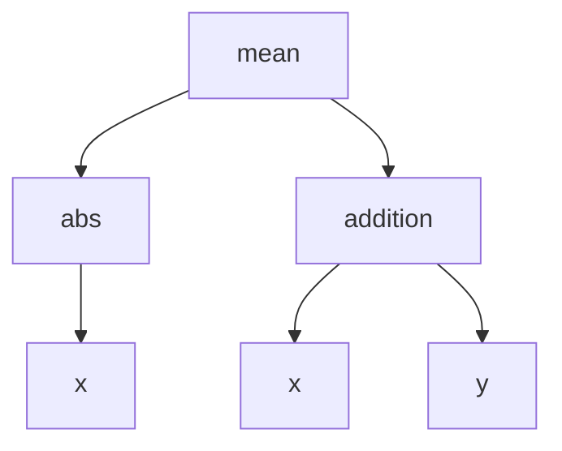
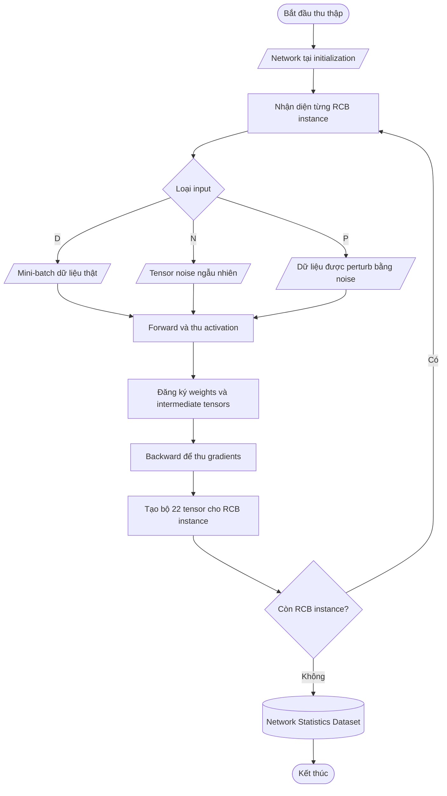
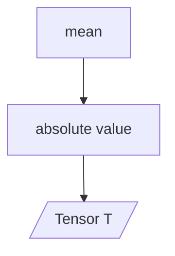
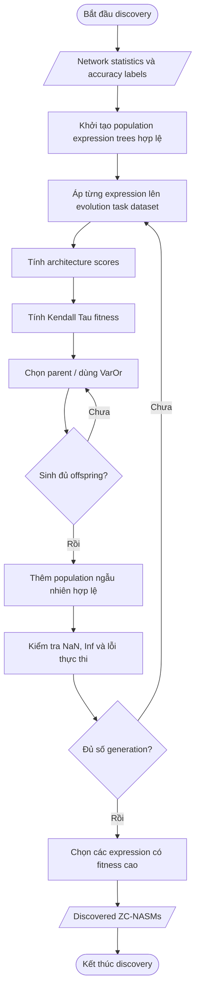

# EZNAS — Evolving Zero-Cost Proxies for Neural Architecture Scoring

> **Đây là bản tổng hợp kiến thức sau khi đọc paper EZNAS**, không phải một checklist đọc paper. Mục tiêu là giải thích vì sao tác giả muốn tự động tìm Zero-Cost Proxy, dữ liệu trung gian được thu thập như thế nào, expression tree hoạt động ra sao, Genetic Programming tối ưu điều gì, và một proxy đã tìm được được áp dụng cho architecture mới như thế nào.
>
> Một điểm phải giữ rõ trong toàn bộ note: **EZNAS là framework khám phá công thức proxy**; **EZNAS-A là một proxy cụ thể được framework tìm ra**. Hai khái niệm này không đồng nghĩa.

---

## 0. Thông tin paper

| Trường | Thông tin |
|---|---|
| Tên gốc | *EZNAS: Evolving Zero-Cost Proxies for Neural Architecture Scoring* |
| Tác giả | Yash Akhauri, J. Pablo Muñoz, Nilesh Jain, Ravishankar Iyer |
| Năm / Hội nghị | 2022 — NeurIPS 2022 |
| DOI | [10.52202/068431-2208](https://doi.org/10.52202/068431-2208) |
| arXiv | [2209.07413](https://arxiv.org/abs/2209.07413) |
| Paper chính thức | [NeurIPS proceedings](https://papers.nips.cc/paper_files/paper/2022/hash/c474dc287c6de27fec2981f812c361e1-Abstract-Conference.html) |
| PDF | [NeurIPS PDF](https://papers.nips.cc/paper_files/paper/2022/file/c474dc287c6de27fec2981f812c361e1-Paper-Conference.pdf) |
| Mã nguồn | [IntelLabs/Hardware-Aware-Automated-Machine-Learning — EZNAS](https://github.com/IntelLabs/Hardware-Aware-Automated-Machine-Learning/tree/main/EZNAS) |

**Lưu ý về mã nguồn:** tại thời điểm ghi note (13/11/2026), repository IntelLabs được GitHub đánh dấu archived/read-only và có thông báo về security issues. Khi thử cài dependency cũ, nên dùng môi trường ảo/container biệt lập, không chạy với quyền cao và không đưa secrets vào môi trường đó. Trạng thái repository có thể thay đổi; kiểm tra trang GitHub trước khi reproduction. [1, official repository]

**Các phần quan trọng:** Section 1 (Introduction), Section 3 (Evolutionary Framework), Sections 3.1–3.7, Algorithm 1, Section 4 (Results), Section 5 (Examination of Best Programs), Section 6 (Discussion and Future Work), Appendix 8.3–8.7. [1]

---

# 1. Bài toán và động lực nghiên cứu

## 1.1. Zero-Cost Proxy là gì?

Trong Neural Architecture Search (NAS), ta thường có một tập nhiều architecture ứng viên. Để biết architecture nào có tiềm năng tốt, cách trực tiếp là training từng mạng rồi đo validation accuracy. Cách này tốn chi phí lớn nếu search space có hàng nghìn hoặc hàng triệu kiến trúc.

**Zero-Cost Proxy (ZCP)** là một chỉ số được tính trên network ở trạng thái chưa training đầy đủ, nhằm ước lượng hoặc xếp hạng chất lượng của architecture. Từ “zero-cost” là cách gọi tương đối: phương pháp tránh chi phí training đầy đủ từng ứng viên, chứ không có nghĩa tính toán hoàn toàn miễn phí.

Một ZCP thường tạo scalar score:

\[
S(A,\theta_0,X),
\]

trong đó:

- \(A\): architecture;
- \(\theta_0\): tham số tại initialization;
- \(X\): input batch nếu proxy cần dữ liệu;
- \(S\): score được tính trước khi training đầy đủ.

Score được kiểm tra bằng cách so sánh thứ hạng với accuracy thật của architecture sau training.

## 1.2. Vấn đề của thiết kế proxy thủ công

Trước EZNAS, nhiều proxy được thiết kế dựa trên trực giác, cơ sở lý thuyết hoặc quá trình thử nghiệm thủ công. Ví dụ:

- NASWOT sử dụng mức overlap giữa activation patterns;
- SynFlow khai thác synaptic saliency;
- SNIP, GraSP, Fisher và các chỉ số khác dùng thông tin gradient/weight theo những cách khác nhau.

Một proxy có thể hoạt động tốt trong một search space nhưng giảm chất lượng khi chuyển sang search space hoặc dataset khác. Vì thế, tác giả đặt câu hỏi:

> Thay vì để con người tự nghĩ ra từng công thức scoring, liệu có thể để thuật toán tự động tìm một biểu thức toán học từ các thống kê của neural network, sao cho biểu thức đó xếp hạng architecture gần với accuracy thật?

Đó là động lực chính của EZNAS. [1, Abstract; Sec. 1–2]

## 1.3. EZNAS không phải một proxy duy nhất

Cần phân biệt:

| Thuật ngữ | Ý nghĩa |
|---|---|
| ZC-NASM | Zero-Cost Neural Architecture Scoring Metric — một công thức tạo score cho architecture |
| EZNAS | Framework dùng Genetic Programming để khám phá ZC-NASM |
| EZNAS-A | Một proxy cụ thể được khám phá trong paper |
| EZNAS-B | Một proxy khác được khám phá và phân tích trong paper |
| Discovery | Giai đoạn tìm kiếm biểu thức proxy |
| Application / Scoring | Giai đoạn áp dụng biểu thức đã tìm được lên architecture mới |

EZNAS không phải “một công thức cố định”. Nó là quy trình tìm công thức. EZNAS-A là một trong những kết quả của quy trình đó. [1, Sec. 3, 5]

## 1.4. Giải thích như cho người mới bắt đầu

Hãy tưởng tượng em muốn tìm công thức chấm điểm cho các architecture.

Em có một số vật liệu:

- trọng số của network;
- activation;
- gradient;
- các thống kê thu được khi đưa input qua network.

Em có thể thử kết hợp các vật liệu đó bằng những phép toán như cộng, nhân, lấy trị tuyệt đối, chuẩn hóa, cosine similarity...

Nhưng có quá nhiều cách kết hợp. Thay vì tự thử từng công thức, EZNAS tạo ra nhiều “công thức ứng viên”, kiểm tra xem công thức nào xếp hạng architecture gần với accuracy thật nhất, rồi giữ và biến đổi các công thức tốt.

Đây chính là Genetic Programming: tiến hóa **chương trình/công thức**, chứ không phải tiến hóa trực tiếp trọng số của neural network.

---

# 2. Cơ sở lý thuyết

## 2.1. Genetic Programming (GP)

Genetic Programming là một nhánh của evolutionary computation, trong đó cá thể trong quần thể có thể là chương trình hoặc biểu thức. Thuật toán tạo một quần thể biểu thức, đánh giá fitness, sau đó dùng các phép biến đổi để tạo thế hệ mới.

Các thành phần chính:

- **Population:** tập các biểu thức ứng viên.
- **Individual / Program:** một biểu thức cụ thể.
- **Fitness:** mức độ tốt của biểu thức.
- **Selection:** chọn biểu thức được ưu tiên sinh con.
- **Crossover:** trao đổi một phần cấu trúc giữa hai biểu thức.
- **Mutation:** thay đổi một phần biểu thức.
- **Reproduction:** giữ lại/copy biểu thức.
- **Generation:** một vòng tiến hóa.

Trong EZNAS, một individual là một ZC-NASM được biểu diễn bằng expression tree.

## 2.2. Expression Tree

Expression tree là cây biểu diễn một biểu thức toán học.

Ví dụ:

\[
f(x,y)=\operatorname{mean}(|x|+y).
\]

Có thể mô tả bằng cây:



- Node lá (terminal) là tensor/thống kê đầu vào.
- Node bên trong là phép toán.
- Root node tạo ra kết quả của chương trình.

Paper dùng expression tree để giảm các phép tính thừa. Tác giả từng thử biểu diễn chương trình tuần tự dạng instruction + memory, nhưng phát hiện chương trình có thể phình to và chứa nhiều operation dư thừa. Expression tree khiến các node đều tham gia vào đường tính đến root, giúp giảm redundancy trong cách biểu diễn. [1, Sec. 3.1; Appendix 8.2]

## 2.3. Fitness và Kendall's Tau

Mục tiêu của ZC-NASM là xếp hạng architecture. Do đó, EZNAS dùng Kendall Tau rank correlation làm fitness.

Với hai bảng xếp hạng, Kendall Tau cơ bản có dạng:

\[
\tau=\frac{C-D}{\binom{n}{2}},
\]

trong đó:

- \(C\): số cặp concordant — hai thứ hạng đồng thuận;
- \(D\): số cặp discordant — hai thứ hạng ngược nhau;
- \(n\): số architecture được so sánh.

Ví dụ, nếu architecture A có accuracy cao hơn B và proxy cũng cho A score cao hơn B, cặp (A,B) là concordant. Nếu accuracy A cao hơn B nhưng proxy cho A score thấp hơn B, cặp đó discordant.

Trong thực nghiệm thật có thể có ties (đồng hạng), vì vậy cần xác định biến thể Kendall được thư viện sử dụng. Không nên tự áp công thức không ties cho dữ liệu có nhiều score giống nhau mà không ghi chú.

Fitness của một chương trình \(P\) trong EZNAS có thể viết:

\[
\boxed{
F(P)=\tau\big(P(A_i),\operatorname{Accuracy}(A_i)\big)
}
\]

Mục tiêu là tối đa hóa fitness trên tập architecture dùng cho evolution. [1, Sec. 3.5.2]

---

# 3. Thu thập thống kê từ Neural Network

Đây là phần quan trọng vì Genetic Programming không làm việc trực tiếp trên toàn bộ model dưới dạng trừu tượng. Nó nhận các tensor/statistics được thu thập từ các khối mạng.

## 3.1. RCB instance

Paper xác định các instance có cấu trúc:

**ReLU → Conv2D → BatchNorm2D (RCB).**

Ở mỗi RCB instance tại initialization, tác giả đăng ký các activation, weights và gradient tương ứng.

## 3.2. Ba loại input

Paper thu thập network statistics dưới ba loại input:

| Ký hiệu | Ý nghĩa | Giải thích đơn giản |
|---|---|---|
| \(\mathcal D\) | Mini-batch dữ liệu | Một batch ảnh từ dataset |
| \(\mathcal N\) | Random noisy tensor | Tensor noise ngẫu nhiên có hình dạng phù hợp |
| \(\mathcal P\) | Perturbed data batch | Batch dữ liệu thật được thêm nhiễu |

Mục đích là cho phép proxy được khám phá truy cập những tín hiệu khác nhau của network khi xử lý data, noise và perturbed data. [1, Sec. 3.2; Fig. 1]

## 3.3. 22 tensor statistics

Paper thu thập:

- \(T1_{\{D,N,P\}}\): 3 tensor;
- \(T2_{\{D,N,P\}}\): 3 tensor;
- \(T3\): 1 tensor — convolution weights, không đổi theo loại input;
- \(T4_{\{D,N,P\}}\): 3 tensor;
- \(T1G_{\{D,N,P\}}\): 3 tensor;
- \(T2G_{\{D,N,P\}}\): 3 tensor;
- \(T3G_{\{D,N,P\}}\): 3 tensor;
- \(T4G_{\{D,N,P\}}\): 3 tensor.

Tổng cộng:

\[
3+3+1+3+3+3+3+3=22.
\]

Trong đó `G` biểu thị các gradient tương ứng. Paper xác nhận:

- \(T3\): Conv2D weights;
- \(T3G_D\): gradient của Conv2D weights khi dùng data mini-batch;
- \(T4_D\): activation;
- \(T4G_D\): activation gradient;
- tương tự, \(T3G_N\) là Conv2D weight gradient khi dùng random noise input.

**Lưu ý về tính chính xác:** Không nên tự gán tên diễn giải chi tiết cho mọi `T1`, `T2`, `T4` nếu chưa đối chiếu đầy đủ sơ đồ Figure 1, Figure 2, supplementary material và official implementation. Trong note này, các tên tensor được giữ theo ký hiệu gốc; những tensor được paper giải thích rõ được chú giải cụ thể. [1, Sec. 3.2; Figs. 1–2]

## 3.4. Sơ đồ thu thập tensor



## 3.5. Vì sao thu thập thống kê theo RCB instance?

Một architecture có thể chứa nhiều khối RCB. Nếu mỗi khối có 22 tensor làm input, đưa toàn bộ tensor của mọi layer vào một expression tree sẽ khiến số terminal tăng rất lớn. Paper nêu rằng nhiều architecture có hơn 100 RCB instances, dẫn tới tối đa khoảng 2.200 terminal inputs nếu đưa tất cả tensor của tất cả instance vào cùng một cây.

Để đơn giản hóa, tác giả xây dựng một expression tree có 22 input terminals, áp dụng cùng cây lên từng RCB instance, rồi tổng hợp score từ các instance. [1, Sec. 3.4]

---

# 4. Expression Tree và cách áp dụng lên architecture

## 4.1. Không gian toán tử

Paper sử dụng 34 toán tử trong program search space. Bao gồm:

- toán tử cơ bản: addition, product;
- toán tử trên tensor: absolute value, power, normalization, ReLU, sign, Heaviside, inverse;
- toán tử thống kê/ma trận: Frobenius norm, determinant;
- phép so sánh/tương đồng: cosine similarity, Hamming distance;
- các phép toán khác được liệt kê trong supplementary material.

Mục tiêu không phải để tạo công thức tùy ý vô hạn, mà là tạo một tập phép toán có thể kết hợp thành các expression tree hợp lệ. [1, Sec. 3.3; Appendix]

## 4.2. Từ expression tree ra score architecture

Một expression tree có thể trả về tensor, không nhất thiết là scalar. Vì score cuối cùng của architecture phải là một số, framework có bước `to_scalar`.

Sau đó cùng expression được áp dụng cho từng RCB instance. Output của các instance được aggregate thành score của architecture:

\[
S_P(A)
=
\operatorname{Agg}_{r\in\operatorname{RCB}(A)}
\left[
\operatorname{to\_scalar}
\left(P(T_{1,r},\ldots,T_{22,r})\right)
\right].
\]

Trong đó:

- \(P\): expression tree;
- \(r\): RCB instance;
- \(T_{1,r},\ldots,T_{22,r}\): các tensor statistics của instance;
- `to_scalar`: biến output của một instance thành scalar;
- `Agg`: tổng hợp score qua các RCB instances.

Trong mô tả Section 3.4, paper nói với EZNAS-A, `aggregation_function` và `to_scalar` đều là mean. Tuy nhiên caption Figure 6 mô tả output EZNAS-A đã là scalar và `to_scalar` không cần thiết trong sơ đồ phân tích đó. Khi reproduction nên theo đúng version/official code và ghi rõ cách xử lý; không nên tự sửa biểu thức chỉ dựa trên một caption. [1, Sec. 3.4; Fig. 6; Appendix 8.6]

## 4.3. Ví dụ expression tree minh họa

Giả sử một chương trình đồ chơi:

\[
P(T)=\operatorname{mean}(|T|).
\]

Cây biểu thức:



Nếu tensor:

\[
T=\begin{bmatrix}-1&2\\3&-4\end{bmatrix},
\]

thì:

\[
|T|=\begin{bmatrix}1&2\\3&4\end{bmatrix},
\quad
P(T)=\frac{1+2+3+4}{4}=2.5.
\]

Đây chỉ là **ví dụ expression tree do em tự tạo để hiểu cơ chế**, không phải công thức EZNAS-A.

---

# 5. Genetic Programming: tiến hóa công thức như thế nào?

## 5.1. Khởi tạo population

EZNAS khởi tạo một population gồm \(n\) programs. Tuy nhiên, phần lớn expression trees được tạo ngẫu nhiên có thể không hợp lệ: sai kích thước tensor, operation không áp dụng được, hoặc tạo ra `NaN`/`Inf`.

Do đó, paper kiểm tra chương trình trên một tập nhỏ statistics trước. Những chương trình lỗi hoặc sinh giá trị không hữu hạn được thay bằng chương trình ngẫu nhiên hợp lệ khác. [1, Sec. 3.5.1]

## 5.2. Tính fitness

Mỗi expression được áp dụng lên các architecture trong evolution space. Nó sinh ra một score cho mỗi architecture. Các score được so với accuracy ground truth để tính Kendall Tau.

\[
F(P)=\tau(\mathbf s_P,\mathbf a),
\]

trong đó:

- \(\mathbf s_P=[P(A_1),\ldots,P(A_m)]\): score do program tạo;
- \(\mathbf a=[a_1,\ldots,a_m]\): ground-truth accuracy;
- \(F(P)\): fitness của program.

Công thức này làm rõ một điểm quan trọng: discovery stage **cần accuracy labels** cho những architecture trong evolution task dataset. Sau khi đã chọn được proxy, việc chấm một architecture mới có thể không cần training architecture đó, nhưng framework discovery không hoàn toàn độc lập với ground-truth accuracy. [1, Sec. 3.5.2–3.7]

## 5.3. Crossover

Crossover chọn hai expression trees, chọn một node/subtree ở mỗi cây, rồi trao đổi hai subtree.

Ví dụ:

- Parent 1: `mean(abs(T3G_N))`
- Parent 2: `sum(power(T4_D))`

Nếu trao đổi subtree phù hợp, có thể tạo hai biểu thức con mới. Việc trao đổi phải đảm bảo chương trình con còn hợp lệ về kiểu tensor và input.

## 5.4. Mutation

Mutation chọn một vị trí trong expression tree rồi thay subtree tại vị trí đó bằng subtree được tạo mới.

Ví dụ:

- Trước: `mean(abs(T3G_N))`
- Sau mutation: `mean(square(T3G_N))`

Đây là ví dụ thay đổi cấu trúc, không phải một biểu thức được paper công bố.

## 5.5. Reproduction và đa dạng population

Paper sử dụng `VarOr` từ thư viện DEAP để sinh offspring bằng crossover, mutation hoặc reproduction. Ngoài ra, một nửa quần thể offspring được tạo ngẫu nhiên hợp lệ nhằm duy trì diversity, giảm việc population quá nhanh hội tụ về các biểu thức giống nhau.

Paper giới hạn độ sâu expression tree tối đa là 10. [1, Sec. 3.5.3]

## 5.6. Flowchart Genetic Programming



---

# 6. Evolution task dataset và cách tránh overfitting

## 6.1. Vì sao không đánh giá trên toàn bộ statistics?

Mỗi expression tree cần được đánh giá trên statistics của nhiều architecture. Paper cho biết khối lượng statistics toàn bộ có thể lên tới khoảng 1 TB; nếu xét nhiều search spaces/datasets có thể vượt 7 TB. Đánh giá mọi chương trình trên toàn bộ tập dữ liệu ở mỗi generation là quá tốn kém. [1, Sec. 3.6]

## 6.2. Vì sao không chỉ dùng một subset cố định nhỏ?

Nếu mọi generation chỉ dùng một tập architecture rất nhỏ cố định để fitness, GP có thể tìm biểu thức chỉ phù hợp với thống kê của đúng subset đó. Đây là overfitting ở cấp độ proxy discovery.

## 6.3. Evolution task dataset trong paper

Paper tạo evolution task dataset bằng cách lấy mẫu 80 networks từ mỗi tổ hợp search space và dataset có sẵn (NAS-Bench-201 và NDS; CIFAR-10, CIFAR-100, ImageNet16-120). Khi đánh giá một individual:

1. Chọn ngẫu nhiên \(s\) search spaces/tasks.
2. Lấy 20 networks từ mỗi task được chọn.
3. Tính fitness trên từng task.
4. Lấy fitness nhỏ nhất qua các task được chọn làm fitness của chương trình.

Trong thí nghiệm của paper, \(s=4\). Dùng minimum fitness khiến chương trình phải hoạt động tương đối tốt trên nhiều task được chọn, thay vì chỉ giỏi trên một task. [1, Sec. 3.6]

## 6.4. Testing trên architecture chưa thấy

Sau evolution, tác giả kiểm tra các chương trình tốt trên architecture chưa được dùng trong discovery. Paper báo cáo đánh giá score-accuracy correlation trên 4.000 architecture được lấy mẫu từ NAS-Bench-201 và NDS. Đây là bước quan trọng để kiểm tra generalization chứ không chỉ fitness trên evolution data. [1, Sec. 3.7]

---

# 7. EZNAS-A và kết quả paper

## 7.1. EZNAS-A là gì?

EZNAS-A là một ZC-NASM được tìm ra bằng evolutionary search, không phải tên gọi của toàn bộ framework EZNAS.

Paper cho biết EZNAS-A được khám phá từ NDS-DARTS trên CIFAR-10. Khi phân tích chương trình, tác giả nhận thấy input chính của biểu thức trong Figure 6 là \(T3G_N\), tức gradient của Conv2D weights khi đưa random noisy tensor qua network. Phân tích hành vi score cho thấy nó liên hệ với kích thước weight/channel và có dạng giống weighted parameter counting. [1, Sec. 5]

Không nên tự viết một công thức đóng cho EZNAS-A nếu chưa chép chính xác expression tree trong Figure 6 hoặc official code. Paper trình bày chương trình cụ thể bằng sơ đồ expression; mô tả văn bản nói rõ input statistics và đặc tính score, nhưng không thay thế việc đối chiếu cây biểu thức.

## 7.2. Kết quả Spearman trên NAS-Bench-201

Bảng dưới trích Table 1 trong paper. Các giá trị là **Spearman rank correlation** giữa proxy score và accuracy ground truth; không phải accuracy phần trăm.

| Proxy | CIFAR-10 | CIFAR-100 | ImageNet16-120 |
|---|---:|---:|---:|
| EZNAS-A | **0.83** | **0.82** | **0.78** |
| SynFlow | 0.74 | 0.76 | 0.75 |
| Jacobian Covariance | 0.73 | 0.71 | 0.71 |
| FLOPs | 0.75 | 0.72 | 0.69 |
| Params | 0.75 | 0.72 | 0.69 |
| Grad Norm | 0.58 | 0.64 | 0.58 |
| SNIP | 0.58 | 0.63 | 0.58 |
| GraSP | 0.48 | 0.54 | 0.56 |
| Fisher | 0.36 | 0.39 | 0.33 |

Nguồn: [1, Table 1]. Những con số này là kết quả do tác giả báo cáo, không phải kết quả em tự chạy.

## 7.3. Kết quả Kendall trên NAS-Bench-201

| Proxy | CIFAR-10 | CIFAR-100 | ImageNet16-120 |
|---|---:|---:|---:|
| EZNAS-A | **0.65** | **0.65** | **0.61** |
| NASWOT | 0.57 | 0.61 | 0.55 |
| AngleNAS | 0.57 | 0.60 | 0.54 |
| FLOPs | 0.56 | 0.54 | 0.50 |
| Params | 0.56 | 0.54 | 0.50 |

Nguồn: [1, Table 3].

## 7.4. Kết quả NATS-Bench SSS

| Proxy | CIFAR-10 | CIFAR-100 | ImageNet16-120 |
|---|---:|---:|---:|
| EZNAS-A | **0.89** | **0.74** | **0.81** |
| NASWOT | 0.45 | 0.18 | 0.41 |

Nguồn: [1, Table 2]. Kết quả cho thấy mức tương quan có thể thay đổi theo search space và dataset; không nên lấy một bảng để kết luận proxy luôn xếp hạng tốt ở mọi bối cảnh.

## 7.5. Chi phí discovery

Paper báo cáo mỗi lần evolution mất khoảng 24 giờ trên Intel Xeon Gold 6242, với máy có RAM rất lớn; phần phụ lục nêu RAM sử dụng có thể khoảng 60 GB tùy số lượng statistics. Việc thu thập statistics và testing còn dùng hạ tầng GPU server. Điều này cho thấy:

- discovery không hề rẻ;
- scoring một architecture mới sau khi đã có proxy có thể rẻ hơn nhiều;
- cần phân biệt chi phí **khám phá proxy** với chi phí **áp dụng proxy**. [1, Sec. 4; Appendix 8.5]

---

# 8. Hạn chế và nhận xét của tác giả

Paper thảo luận một số giới hạn quan trọng. [1, Sec. 6]

## 8.1. Không mô hình hóa rõ connectivity toàn network

EZNAS áp expression lên từng RCB instance rồi aggregate bằng mean. Cách này không trực tiếp mô hình hóa global connectivity giữa các layer. Một hướng mở rộng là dùng cấu trúc kết nối toàn mạng hoặc học trọng số cho điểm của từng layer.

## 8.2. Phụ thuộc vào cấu trúc RCB

Program representation dùng RCB structure. Với kiến trúc có block khác hoặc nhiều convolution liên tiếp, pipeline thu thập statistics cần điều chỉnh. Điều này hạn chế tính tổng quát của cách thu thập dữ liệu nếu search space đa dạng hơn.

## 8.3. Không so sánh trực tiếp nhiều input samples

Thiết kế program gốc dùng một mini-batch và không trực tiếp so sánh các input samples với nhau. Tác giả nói rõ vì thế framework hiện tại không thể tự khám phá NASWOT metric theo đúng cơ chế pairwise binary code comparison nếu chưa mở rộng program representation. [1, Sec. 6]

## 8.4. Khó phân biệt nhóm architecture tốt nhất

Paper ghi nhận EZNAS-A có thể xếp hạng architecture tương đối tốt trên search spaces, nhưng không xếp hạng hiệu quả nhóm top 10% architecture trong một số phân tích. Tác giả thảo luận rằng đây có thể là giới hạn của ZC-NASM trong việc phân biệt những model rất tốt với nhau. [1, Sec. 6]

## 8.5. Discovery có nguy cơ overfit

Dùng subset cố định nhỏ gây overfit; do đó paper xây dựng evolution task dataset và kiểm tra trên architecture chưa thấy. Khi tự mở rộng EZNAS, cần tách discovery, validation và test ở cấp architecture/search space/dataset.

---

# 9. Code minh họa: Expression Tree và fitness

## 9.1. Biểu diễn một expression đơn giản

Ví dụ dưới đây tạo một biểu thức minh họa `mean(abs(T3G_N))`. Đây **không phải EZNAS-A chính thức**; mục đích là cho thấy cách một expression nhận tensor và trả ra scalar.

```python
from dataclasses import dataclass
from typing import Dict
import torch


@dataclass
class InputNode:
    name: str

    def evaluate(self, stats: Dict[str, torch.Tensor]) -> torch.Tensor:
        if self.name not in stats:
            raise KeyError(f"Thiếu tensor statistic: {self.name}")
        return stats[self.name]


@dataclass
class AbsMeanNode:
    child: InputNode

    def evaluate(self, stats: Dict[str, torch.Tensor]) -> torch.Tensor:
        value = self.child.evaluate(stats)
        return value.abs().mean()


# Expression minh họa: mean(abs(T3G_N))
program = AbsMeanNode(InputNode("T3G_N"))

stats = {
    "T3G_N": torch.tensor([-1.0, 2.0, -3.0, 4.0])
}

score = program.evaluate(stats)
print(float(score))  # 2.5
```

## 9.2. Tính Kendall fitness

```python
import numpy as np
from scipy.stats import kendalltau

proxy_scores = np.array([0.9, 0.2, 0.7, 0.4])
true_accuracy = np.array([0.92, 0.65, 0.88, 0.71])

result = kendalltau(proxy_scores, true_accuracy)
fitness = result.statistic

print("Kendall Tau:", fitness)
```

Đây là ví dụ minh họa fitness. EZNAS gốc có nhiều chi tiết bổ sung: expression validation, evolution task dataset, variation functions, population handling và các tham số tìm kiếm.

## 9.3. Những phần cần có trong reproduction thật

- Tensor collection theo RCB instances;
- đủ 22 statistic tensors theo định nghĩa paper;
- 34 mathematical operators;
- expression tree representation;
- `to_scalar` và `aggregation_function` đúng cấu hình;
- validity checking để loại chương trình lỗi/NaN/Inf;
- Genetic Programming với DEAP hoặc implementation tương ứng;
- evolution task dataset;
- discovery / validation / test separation;
- kiểm tra generalization trên architecture chưa thấy.

Chạy một expression toy không được gọi là reproduce EZNAS.

---

# 10. Tóm tắt kiến thức EZNAS

```text
Tập architecture có ground-truth accuracy
    ↓
Khởi tạo network và thu thập 22 tensor statistics / RCB
    ↓
Tạo các expression tree ứng viên
    ↓
Áp expression lên các RCB instances
    ↓
Aggregate layer scores thành architecture score
    ↓
So sánh score với accuracy bằng Kendall Tau
    ↓
Fitness
    ↓
Selection / Crossover / Mutation / Reproduction
    ↓
Lặp qua nhiều generation
    ↓
Chọn ZC-NASM tốt
    ↓
Kiểm tra trên architecture chưa thấy
    ↓
Dùng proxy đã khám phá để score architecture mới
```

**Ý chính:** EZNAS tự động tìm công thức Zero-Cost Neural Architecture Scoring Metric bằng Genetic Programming, sử dụng các thống kê trung gian của network và fitness dựa trên Kendall Tau với accuracy. Discovery cần ground-truth accuracy trên evolution task dataset; scoring architecture mới không đòi hỏi training đầy đủ từng architecture.

---

# 11. Tài liệu tham khảo

[1] Akhauri, Y., Muñoz, J. P., Jain, N., & Iyer, R. (2022). *EZNAS: Evolving Zero-Cost Proxies for Neural Architecture Scoring*. Advances in Neural Information Processing Systems 35. [arXiv](https://arxiv.org/abs/2209.07413) · [NeurIPS](https://papers.nips.cc/paper_files/paper/2022/hash/c474dc287c6de27fec2981f812c361e1-Abstract-Conference.html) · [Official repository](https://github.com/IntelLabs/Hardware-Aware-Automated-Machine-Learning/tree/main/EZNAS).

[2] Mellor, J., Turner, J., Storkey, A., & Crowley, E. J. (2021). *Neural Architecture Search without Training*. ICML. [Paper](https://arxiv.org/abs/2006.04647).

[3] Tanaka, H., Kunin, D., Yamins, D. L. K., & Ganguli, S. (2020). *Pruning Neural Networks without Any Data by Iteratively Conserving Synaptic Flow*. NeurIPS. [Paper](https://arxiv.org/abs/2006.05467).

[4] Fortin, F.-A., et al. (2012). *DEAP: Evolutionary Algorithms Made Easy*. Journal of Machine Learning Research. [JMLR](https://www.jmlr.org/papers/v13/fortin12a.html).

---

## Ghi chú học tập của em

- Phần em đã hiểu chắc:
- Phần cần đọc lại trong paper:
- Tensor statistics cần đối chiếu với official code:
- Phần Genetic Programming cần thực hành:
- Kết quả reproduction em đã tự chạy:
- Câu hỏi muốn trao đổi với thầy:
