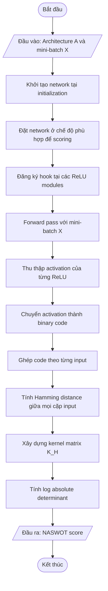
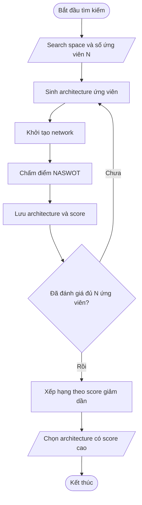

# NASWOT — Neural Architecture Search without Training

> **Đây là bản ghi chép kiến thức sau khi đọc paper**, không phải checklist đọc paper. Nội dung đi từ bài toán, trực giác, nền tảng toán học, công thức, thuật toán, ví dụ tính tay, cách triển khai, thực nghiệm gốc đến nhận xét và mối liên hệ với các phương pháp khác.
>
> Những nội dung được diễn giải lại bằng tiếng Việt nhằm giúp em hiểu và có thể tự giải thích thuật toán. Các ví dụ số và code tối giản trong note này là ví dụ minh họa do em xây dựng, không phải số liệu thực nghiệm của tác giả. Kết quả thực nghiệm được trích từ paper sẽ được ghi rõ nguồn.

---

## 0. Thông tin paper

| Trường | Thông tin |
|---|---|
| Tên paper | *Neural Architecture Search without Training* |
| Tác giả | Joseph Mellor, Jack Turner, Amos Storkey, Elliot J. Crowley |
| Năm / Hội nghị | 2021 — International Conference on Machine Learning (ICML) |
| Nơi xuất bản | Proceedings of Machine Learning Research, Vol. 139, pp. 7588–7598 |
| arXiv | [2006.04647](https://arxiv.org/abs/2006.04647) |
| Paper chính thức | [PMLR](https://proceedings.mlr.press/v139/mellor21a.html) |
| PDF | [PMLR PDF](https://proceedings.mlr.press/v139/mellor21a/mellor21a.pdf) |
| Mã nguồn | [BayesWatch/nas-without-training](https://github.com/BayesWatch/nas-without-training) |

**Vị trí nên đọc trong paper:** Section 1 (Introduction), Section 3 (Scoring Networks at Initialisation), Section 3.1 (Ablation Study), Section 4 (NASWOT), Algorithm 1 và Algorithm 2 (AREA), Appendix A–B. Công thức chính nằm ở Eq. (1)–(2). [1]

---

# 1. Bài toán và động lực nghiên cứu

## 1.1. Neural Architecture Search là gì?

Một Neural Network không chỉ được quyết định bởi dữ liệu và cách training. Cấu trúc của mạng cũng ảnh hưởng lớn đến khả năng học: số layer, số channel, phép convolution, pooling, skip connection và cách các phép toán được kết nối.

**Neural Architecture Search (NAS)** là hướng nghiên cứu tự động tìm một kiến trúc phù hợp trong một tập kiến trúc có thể có rất nhiều lựa chọn.

Gọi tập kiến trúc là:

\[
\mathcal{A}=\{A_1,A_2,\ldots,A_M\}.
\]

Với cách đánh giá truyền thống, mỗi kiến trúc thường cần được khởi tạo, training một phần hoặc toàn bộ, rồi đo validation accuracy:

\[
A^*=\arg\max_{A_i\in\mathcal{A}}
\operatorname{Acc}_{\mathrm{val}}(A_i).
\]

Nếu có hàng nghìn kiến trúc, việc training từng kiến trúc khiến NAS tốn thời gian, GPU và năng lượng. Đây là nút thắt mà nhiều phương pháp NAS tìm cách giảm bớt. [1, Sec. 1]

## 1.2. NASWOT đặt câu hỏi gì?

NASWOT đặt ra câu hỏi:

> **Có thể đánh giá sơ bộ một neural network ngay tại thời điểm khởi tạo, trước khi training, bằng cách quan sát cách các input tạo ra những activation pattern khác nhau hay không?**

Thay vì training từng kiến trúc rồi mới biết accuracy, NASWOT quan sát các phản ứng của ReLU units khi một mini-batch đi qua network chưa training. Từ những phản ứng đó, phương pháp xây dựng một kernel matrix và tính một scalar score.

Score này được dùng để xếp hạng các kiến trúc ứng viên. Paper cho thấy score có tương quan với validation accuracy sau training trên nhiều search spaces được khảo sát. Đây là **mối tương quan thực nghiệm**, không phải định lý bảo đảm một kiến trúc có NASWOT score cao chắc chắn đạt accuracy cao. [1, Abstract; Sec. 3–4]

## 1.3. Giải thích bằng ví dụ rất đơn giản

Hãy tưởng tượng trong một network có 4 “công tắc”. Mỗi công tắc đại diện cho một ReLU unit:

- Tín hiệu trước ReLU dương: công tắc bật, ghi là `1`.
- Tín hiệu trước ReLU không dương: công tắc tắt, ghi là `0`.

Khi ảnh A đi qua mạng, ta có thể nhận được mẫu `1101`. Ảnh B tạo mẫu `1001`. Hai mẫu chỉ khác nhau ở một vị trí. Ảnh C tạo mẫu `0011`, khác ảnh A ở ba vị trí.

NASWOT sử dụng sự giống và khác nhau giữa các mẫu bật/tắt này. Nếu hai input tạo ra activation code giống nhau, chúng nằm trong cùng một cấu hình activation của mạng. Nếu code khác nhau, chúng đi qua các cấu hình ReLU khác nhau.

Ví dụ công tắc chỉ giúp hình dung. Network thật có thể có hàng nghìn hoặc hàng triệu activation entries được thu thập từ nhiều ReLU units và nhiều layer.

## 1.4. NASWOT không trực tiếp đo điều gì?

NASWOT **không trực tiếp tính**:

- classification accuracy;
- validation loss;
- corruption accuracy;
- adversarial robustness;
- generalization error;
- khả năng chống Gaussian noise, blur, fog hoặc JPEG compression.

Nó tính một proxy từ activation patterns ở initialization. Accuracy sau training là **ground-truth target** để kiểm tra proxy có xếp hạng đúng hay không.

Điểm này rất quan trọng khi mở rộng nghiên cứu: không được gọi NASWOT là một corruption-robustness metric chỉ vì ta đưa ảnh corrupted vào để tính score. Khi thay input bằng corrupted images, đó là một **biến thể thí nghiệm của NASWOT**, cần được đặt tên và đánh giá riêng.

---

# 2. Nền tảng lý thuyết

## 2.1. ReLU và trạng thái active / inactive

Hàm ReLU được định nghĩa:

\[
\phi(z)=\operatorname{ReLU}(z)=\max(0,z).
\]

Có hai trường hợp:

\[
\phi(z)=
\begin{cases}
z,&z>0,\\
0,&z\leq 0.
\end{cases}
\]

Để chỉ ghi lại trạng thái bật/tắt, ta dùng chỉ báo nhị phân:

\[
c(z)=
\begin{cases}
1,&z>0,\\
0,&z\leq 0.
\end{cases}
\]

Ở đây, `1` không phải output của ReLU; nó là **mã trạng thái** cho biết ReLU đang active. Output ReLU thực tế vẫn là \(\max(0,z)\).

### Ví dụ

| Giá trị trước ReLU \(z\) | Output ReLU | Mã trạng thái |
|---:|---:|---:|
| 2.5 | 2.5 | 1 |
| 0.3 | 0.3 | 1 |
| 0 | 0 | 0 |
| -1.2 | 0 | 0 |

## 2.2. Activation pattern

Giả sử ta xét tất cả ReLU units trong mạng. Với input thứ \(i\), ghép các trạng thái active/inactive thành một vector:

\[
\mathbf c_i=(c_{i,1},c_{i,2},\ldots,c_{i,N_A})
\in\{0,1\}^{N_A}.
\]

Trong đó:

- \(i\): chỉ số input trong mini-batch;
- \(j\): chỉ số ReLU unit;
- \(N_A\): tổng số ReLU units được xét;
- \(c_{i,j}\): trạng thái của unit \(j\) khi xử lý input \(i\).

Nếu mini-batch có \(B\) ảnh thì ta có \(B\) activation codes. Có thể xếp chúng thành ma trận:

\[
C\in\{0,1\}^{B\times N_A}.
\]

Mỗi hàng tương ứng một input; mỗi cột tương ứng một ReLU unit.

## 2.3. Vì sao activation pattern liên quan đến linear region?

Một mạng chỉ gồm các phép tuyến tính xen kẽ ReLU là một hàm **piecewise linear** — tuyến tính từng vùng.

Khi trạng thái active/inactive của các ReLU được cố định, mỗi ReLU có thể được xem như một phép nhân với 1 hoặc 0. Khi đó, mạng trong vùng tương ứng được biểu diễn bằng một chuỗi các ánh xạ tuyến tính có chèn các ma trận chẩn đoán 0/1.

Vì vậy, activation code xác định một cấu hình linear region của mạng ReLU. Hai input có cùng code sẽ kích hoạt cùng một cấu hình ReLU trong cách mô tả này. [1, Sec. 3]

**Trực giác:** nếu hai ảnh có cùng mẫu bật/tắt, network tại initialization đang phản ứng với chúng theo cùng một cấu hình tuyến tính. Nếu code khác nhau, chúng tạo ra cấu hình phản ứng khác nhau.

**Giới hạn của trực giác:** cùng activation code không có nghĩa hai ảnh chắc chắn không thể được phân loại khác nhau sau training. NASWOT dùng đây như một tín hiệu khởi tạo có ích trong thực nghiệm, không phải một kết luận tuyệt đối về khả năng học.

## 2.4. Hamming distance

Với hai vector nhị phân \(\mathbf c_i\) và \(\mathbf c_j\), Hamming distance đếm số vị trí khác nhau:

\[
d_H(\mathbf c_i,\mathbf c_j)
=\sum_{k=1}^{N_A}
\mathbb{1}[c_{i,k}\neq c_{j,k}].
\]

Trong đó \(\mathbb{1}[\cdot]\) bằng 1 nếu điều kiện đúng và bằng 0 nếu sai.

### Ví dụ tính bằng tay

\[
\mathbf c_A=1101,\qquad
\mathbf c_B=1001.
\]

| Vị trí | A | B | Khác nhau? |
|---:|---:|---:|---:|
| 1 | 1 | 1 | 0 |
| 2 | 1 | 0 | 1 |
| 3 | 0 | 0 | 0 |
| 4 | 1 | 1 | 0 |

Do đó:

\[
d_H(\mathbf c_A,\mathbf c_B)=1.
\]

Nếu hai code giống nhau hoàn toàn thì khoảng cách bằng 0. Nếu cả bốn vị trí đều khác thì khoảng cách bằng 4.

---

# 3. Công thức NASWOT

## 3.1. Kernel matrix từ activation overlap

Giả sử mini-batch có \(B\) input và mỗi activation code có \(N_A\) phần tử. NASWOT định nghĩa kernel matrix:

\[
\boxed{
K_H(i,j)=N_A-d_H(\mathbf c_i,\mathbf c_j)
}
\tag{1}
\]

Đây là Eq. (1) trong Section 3 của paper. [1, Eq. (1)]

Ý nghĩa từng thành phần:

- \(K_H(i,j)\): mức overlap activation giữa input \(i\) và \(j\);
- \(N_A\): tổng số ReLU units được xét;
- \(d_H\): số trạng thái activation khác nhau.

Có thể viết tương đương:

\[
K_H(i,j)=\sum_{k=1}^{N_A}
\mathbb{1}[c_{i,k}=c_{j,k}].
\]

Hai biểu thức tương đương vì tại mỗi vị trí, hoặc trạng thái giống nhau, hoặc khác nhau.

### Một số tính chất

1. **Đối xứng:** \(K_H(i,j)=K_H(j,i)\), vì Hamming distance đối xứng.
2. **Đường chéo:** \(K_H(i,i)=N_A\), vì một code so với chính nó có khoảng cách 0.
3. **Giá trị:** \(0\leq K_H(i,j)\leq N_A\).
4. **Kích thước:** \(K_H\in\mathbb R^{B\times B}\).

Kernel overlap này cũng có thể hiểu như tổng các ma trận tương đồng nhị phân theo từng ReLU unit. Với từng unit, ma trận “cùng trạng thái” có thể biểu diễn từ vector chỉ báo active/inactive, vì thế kernel lý tưởng có cấu trúc positive semidefinite. Trong code thực tế vẫn phải kiểm tra numerical stability.

### Vì sao kernel này positive semidefinite?

Với ReLU unit thứ \(k\), gom trạng thái của mọi input thành vector \(\mathbf c_{:,k}\). Ma trận thể hiện “cùng trạng thái” ở unit đó có thể viết:

\[
K^{(k)}=\mathbf c_{:,k}\mathbf c_{:,k}^{T}+(\mathbf 1-\mathbf c_{:,k})(\mathbf 1-\mathbf c_{:,k})^{T}.
\]

Mỗi hạng là một outer product, nên positive semidefinite. Cộng qua mọi ReLU units:

\[
K_H=\sum_{k=1}^{N_A}K^{(k)}
\]

cho ta một ma trận positive semidefinite trong cách xây dựng này. Điều đó giải thích vì sao kernel phù hợp để phân tích bằng determinant/eigenvalues. Tuy nhiên, ma trận vẫn có thể suy biến nếu các activation codes phụ thuộc tuyến tính; khi triển khai vẫn cần kiểm tra conditioning và numerical stability.

### Chi phí tính toán

Với batch size \(B\) và tổng số ReLU units \(N_A\):

- Thu activation và binary codes: tỷ lệ với tổng số activation cần lưu;
- Tính pairwise Hamming distance theo cách trực tiếp: \(O(B^2N_A)\);
- Lưu kernel matrix: \(O(B^2)\);
- Tính log-determinant bằng phân rã ma trận: xấp xỉ \(O(B^3)\).

Do đó, tăng batch size làm tăng chi phí pairwise và kích thước kernel nhanh. Có thể dùng chunking/vectorization để giảm memory peak khi tạo kernel, nhưng phép phân rã ma trận vẫn cần được tính.

## 3.2. Ví dụ xây dựng Kernel Matrix

Giả sử có ba input và bốn ReLU units:

| Input | ReLU 1 | ReLU 2 | ReLU 3 | ReLU 4 |
|---|---:|---:|---:|---:|
| A | 1 | 1 | 0 | 1 |
| B | 1 | 0 | 0 | 1 |
| C | 0 | 0 | 1 | 1 |

Ta tính:

\[
\begin{aligned}
d_H(A,B)&=1,\\
d_H(A,C)&=3,\\
d_H(B,C)&=2.
\end{aligned}
\]

Với \(N_A=4\):

\[
K_H=
\begin{bmatrix}
4&3&1\\
3&4&2\\
1&2&4
\end{bmatrix}.
\]

Kiểm tra từng phần tử:

- \(K_H(A,A)=4\): A giống chính nó ở cả bốn vị trí.
- \(K_H(A,B)=4-1=3\): A và B giống nhau ở ba vị trí.
- \(K_H(A,C)=4-3=1\): A và C chỉ giống nhau ở một vị trí.
- \(K_H(B,C)=4-2=2\): B và C giống nhau ở hai vị trí.

Với ma trận minh họa này:

\[
\det(K_H)=20,
\qquad
s=\log 20\approx 2.9957.
\]

Đây là **ví dụ tự tạo để học cách tính**, không phải score được báo cáo trong paper.

## 3.3. Log-determinant score

Sau khi có kernel matrix, NASWOT tính:

\[
\boxed{s=\log|K_H|}
\tag{2}
\]

Trong ký hiệu đại số tuyến tính, dấu gạch đứng quanh một ma trận ở biểu thức này biểu thị định thức của ma trận. Vì vậy có thể viết rõ hơn:

\[
s=\log\left|\det(K_H)\right|.
\]

Đây là Eq. (2) trong paper. [1, Eq. (2)]

### Determinant có ý nghĩa gì?

Với một ma trận vuông, determinant là một đại lượng liên quan đến hệ số co giãn thể tích của phép biến đổi tuyến tính. Với Gram/kernel matrix, determinant còn phản ánh mức độ “độc lập” của các vector/biểu diễn liên quan: nếu các hàng/cột phụ thuộc tuyến tính mạnh, determinant có thể nhỏ hoặc bằng 0.

Một hình dung đơn giản:

- Nếu các input tạo ra activation codes gần như giống hệt nhau, các hàng/cột của kernel matrix có thể rất giống nhau.
- Khi các hàng/cột phụ thuộc mạnh, determinant có xu hướng giảm.
- Khi cấu trúc các mẫu đa dạng hơn, determinant có thể lớn hơn.

Paper quan sát rằng, với hai kernel có cùng trace, score cao hơn khi kernel gần dạng đường chéo hơn. Tác giả dùng điều này để giải thích vì sao score có thể báo hiệu khả năng đạt accuracy tốt hơn sau training. [1, Sec. 3]

**Không nên diễn giải quá mức:** determinant không trực tiếp đo số lớp được phân biệt, không trực tiếp đo margin phân loại và cũng không phải robustness metric.

### Vì sao dùng log?

Determinant có thể rất lớn hoặc rất nhỏ khi ma trận có kích thước lớn. Dùng log giúp đưa tích các eigenvalues về tổng log-eigenvalues:

\[
\log\det(K_H)=\sum_{i=1}^{B}\log\lambda_i,
\]

nếu ma trận đối xứng positive definite với eigenvalues dương \(\lambda_i\).

Log giúp xử lý scale số tốt hơn, dù không loại bỏ mọi vấn đề numerical stability.

### Chi phí tính toán

Với batch size \(B\) và tổng số ReLU units \(N_A\):

- Thu activation và tạo binary codes: tỷ lệ với số activation được tính;
- So sánh mọi cặp code theo cách trực tiếp: \(O(B^2N_A)\);
- Lưu kernel matrix: \(O(B^2)\);
- Tính determinant/log-determinant bằng phân rã ma trận: xấp xỉ \(O(B^3)\).

Đây là lý do tăng batch size không chỉ tăng lượng input cần forward mà còn làm kernel matrix lớn hơn theo bình phương và phép phân rã ma trận tăng theo bậc ba. Có thể dùng vector hóa/chunking để giảm memory peak khi tạo kernel, nhưng determinant vẫn là một bước đáng chú ý.

### Vấn đề ma trận suy biến

Nếu hai input có activation codes trùng hoàn toàn hoặc các code phụ thuộc tuyến tính, kernel matrix có thể singular:

\[
\det(K_H)=0
\quad\Rightarrow\quad
\log 0=-\infty.
\]

Trong implementation, thường dùng `torch.linalg.slogdet` thay vì tính determinant trực tiếp. Có thể thêm jitter:

\[
K_\epsilon=K_H+\epsilon I.
\]

Jitter là biện pháp số học trong implementation; phải ghi rõ giá trị \(\epsilon\), vì nó làm thay đổi ma trận được score so với công thức lý tưởng trong paper.

---

# 4. Flowchart và thuật toán

## 4.1. Quy ước hình dạng

- Oval: bắt đầu / kết thúc.
- Bình hành: đầu vào / đầu ra.
- Chữ nhật: thao tác xử lý.
- Hình thoi: điều kiện rẽ nhánh.
- Mũi tên: luồng thực thi.

## 4.2. Flowchart tính NASWOT score cho một architecture



## 4.3. Flowchart dùng NASWOT để tìm kiếm kiến trúc



Paper Algorithm 1 mô tả quy trình lấy mẫu ngẫu nhiên architecture, tính score, giữ architecture có score cao nhất. Paper cũng đề xuất Assisted Regularised Evolution (AREA), dùng NASWOT để lọc population khởi đầu trước khi tiếp tục Regularised Evolution. [1, Sec. 4; Algorithms 1–2]

## 4.4. Pseudocode rút gọn

```text
INPUT: search space A, number of samples M, input batch X
best_architecture = None
best_score = -infinity

FOR m = 1 ... M:
    A_m = sample_architecture(A)
    initialize network f_m
    C_m = collect_relu_binary_codes(f_m, X)
    K_m = activation_overlap_kernel(C_m)
    s_m = log_abs_determinant(K_m)

    IF s_m > best_score:
        best_score = s_m
        best_architecture = A_m

RETURN best_architecture, best_score
```

Pseudocode trên tóm tắt scoring/search. Nó không thay thế đầy đủ implementation và cấu hình của từng benchmark trong paper.

---

# 5. Ví dụ triển khai bằng PyTorch

## 5.1. Ý tưởng triển khai

Trong PyTorch, có thể dùng `forward hook` để lấy output của các `nn.ReLU` modules. Với ReLU, output dương tương ứng active; output bằng 0 tương ứng inactive. Sau đó:

1. flatten các chiều ngoài batch;
2. ghép trạng thái của từng ReLU module;
3. so sánh các code theo cặp input;
4. tạo kernel matrix;
5. dùng `torch.linalg.slogdet` để tính log-absolute-determinant.

## 5.2. Code tối giản

```python
from __future__ import annotations

from typing import List
import torch
from torch import nn


def naswot_score(
    model: nn.Module,
    inputs: torch.Tensor,
    eps: float = 1e-6,
) -> float:
    """Tính NASWOT-style score từ output của các nn.ReLU modules.

    Đây là implementation tối giản để học cơ chế. Nó không bao phủ
    mọi chi tiết của official implementation hoặc mọi dạng kiến trúc.
    """
    device = inputs.device
    activation_codes: List[torch.Tensor] = []
    handles = []

    def hook_fn(_module, _inputs, output):
        if not isinstance(output, torch.Tensor):
            raise TypeError("ReLU output phải là Tensor.")
        # Giữ chiều batch đầu tiên, flatten toàn bộ chiều còn lại.
        code = (output > 0).reshape(output.shape[0], -1)
        activation_codes.append(code.detach())

    relu_modules = [m for m in model.modules() if isinstance(m, nn.ReLU)]
    if not relu_modules:
        raise ValueError("Không tìm thấy nn.ReLU module trong model.")

    previous_training_states = {m: m.training for m in model.modules()}

    try:
        model.eval()
        for module in relu_modules:
            handles.append(module.register_forward_hook(hook_fn))

        with torch.no_grad():
            _ = model(inputs)

        if not activation_codes:
            raise RuntimeError("Không thu được activation code.")

        codes = torch.cat(activation_codes, dim=1).to(device=device)
        batch_size, num_units = codes.shape

        # K[i,j] = số vị trí activation giống nhau giữa input i và j.
        kernel = torch.zeros(
            (batch_size, batch_size),
            dtype=torch.float64,
            device=device,
        )

        # Cộng theo từng feature để tránh tạo tensor B x B x N_A quá lớn.
        codes = codes.to(torch.bool)
        for feature_idx in range(num_units):
            bit = codes[:, feature_idx].to(torch.float64)
            same_state = (
                bit[:, None] * bit[None, :]
                + (1.0 - bit[:, None]) * (1.0 - bit[None, :])
            )
            kernel += same_state

        # Jitter giúp giảm lỗi khi kernel gần suy biến.
        kernel = kernel + eps * torch.eye(
            batch_size, dtype=kernel.dtype, device=device
        )
        sign, logabsdet = torch.linalg.slogdet(kernel)

        if sign <= 0 or not torch.isfinite(logabsdet):
            raise RuntimeError(
                "Kernel không cho log-determinant hữu hạn/dương; "
                "hãy kiểm tra activation, batch và eps."
            )
        return float(logabsdet.item())

    finally:
        for handle in handles:
            handle.remove()
        # Khôi phục trạng thái train/eval riêng của từng module.
        for module, was_training in previous_training_states.items():
            module.training = was_training
```

### Điều code đang làm tương ứng với công thức nào?

| Code | Ý nghĩa toán học |
|---|---|
| `output > 0` | Binary activation indicator \(c_{i,j}\) |
| `reshape(batch, -1)` | Ghép activation units thành code \(\mathbf c_i\) |
| `same_state` | \(\mathbb 1[c_{i,k}=c_{j,k}]\) |
| `kernel += same_state` | Cộng overlap qua các units, tạo \(K_H\) |
| `torch.linalg.slogdet` | Tính dấu và log absolute determinant |

**Giới hạn của code mẫu:**

- Chỉ bắt `nn.ReLU`; nếu model gọi `torch.nn.functional.relu` trực tiếp, hook này không bắt được.
- `nn.ReLU6`, GELU, SiLU không được tự động xem là ReLU trong công thức gốc.
- Code cộng kernel theo từng feature để tiết kiệm bộ nhớ nhưng vẫn có vòng lặp Python; có thể tối ưu bằng phép toán vector hóa/chunking.
- Jitter làm thay đổi score một lượng nhỏ; cần cố định `eps` trong mọi lần so sánh.
- Mô hình có BatchNorm phải dùng chế độ được quy định nhất quán trong thí nghiệm.
- Đây là minimal example, chưa phải full reproduction của NASWOT.

## 5.3. Kiểm tra nhanh

```python
# Ví dụ sử dụng
model = nn.Sequential(
    nn.Flatten(),
    nn.Linear(28 * 28, 128),
    nn.ReLU(),
    nn.Linear(128, 64),
    nn.ReLU(),
    nn.Linear(64, 10),
).cuda()

x = torch.randn(16, 1, 28, 28, device="cuda")
score = naswot_score(model, x)
print("NASWOT score:", score)
```

Đây chỉ kiểm tra code có thể tính score trên model nhỏ. Không thể lấy score của một model MNIST ngẫu nhiên rồi kết luận về hiệu quả của paper trên NAS-Bench-201.

---

# 6. Thực nghiệm gốc trong paper

## 6.1. Search spaces và datasets

Paper khảo sát các benchmark/search spaces gồm:

- NAS-Bench-101;
- NAS-Bench-201;
- NATS-Bench (bao gồm SSS trong các thí nghiệm được báo cáo);
- Network Design Spaces (NDS): AmoebaNet, DARTS, ENAS, NASNet, PNAS.

Các dataset gồm CIFAR-10, CIFAR-100, ImageNet16-120 và một thí nghiệm NDS-DARTS trên ImageNet dùng ImageNette2 làm mini-batch tính score. [1, Sec. 2–4; Appendix]

## 6.2. Cách đánh giá

Tác giả lấy mẫu các architecture, tính score trên network chưa training, rồi đối chiếu với validation accuracy khi các architecture đó được training theo benchmark. Trong phần lớn các search spaces, paper lấy khoảng 1.000 networks; một số tập NDS có ít mẫu hơn do giới hạn GPU memory. [1, Sec. 4]

Hai loại số liệu cần phân biệt:

- **NASWOT score:** tính ở initialization.
- **Validation accuracy:** lấy từ mô hình sau training/benchmark.

Tương quan giữa hai đại lượng cho biết score có giữ được thứ tự architecture tốt đến đâu.

## 6.3. Ablation về input batch

Tác giả kiểm tra mức độ phụ thuộc vào mini-batch bằng cách tính score trên nhiều mini-batches CIFAR-100 khác nhau cho một số architecture. Họ cũng thử input ngẫu nhiên phân phối chuẩn. Kết quả cho thấy thứ hạng score tương đối bền vững với lựa chọn mini-batch trong các thiết lập đó; điều này là bằng chứng thực nghiệm, không có nghĩa score hoàn toàn độc lập với input. [1, Sec. 3.1]

Paper cũng khảo sát ảnh hưởng batch size. Kernel matrix thay đổi theo batch size nên tác giả chuẩn hóa score để so sánh giữa các batch sizes. Vì vậy khi reproduction, cần ghi lại batch size và không so sánh trực tiếp score thô của các batch size khác nhau mà không có thiết kế phù hợp. [1, Sec. 3.1]

## 6.4. Ablation về initialization

Paper kiểm tra các lần khởi tạo khác nhau để xem score có phụ thuộc quá mức vào random initialization không. Kết quả cho thấy ranking/quan hệ với performance có độ bền nhất định trong các thí nghiệm được báo cáo. Em nên tái hiện kiểm tra này thay vì chỉ chạy một seed.

## 6.5. Tích hợp với Regularised Evolution

Paper đề xuất Assisted Regularised Evolution (AREA): dùng NASWOT để chọn population khởi đầu có score tốt, sau đó tiếp tục search bằng Regularised Evolution. Trong thí nghiệm, tác giả lấy mẫu một population ban đầu lớn hơn và dùng score để giữ các architecture tốt trước khi chạy vòng evolution. [1, Sec. 4.1; Algorithm 2]

## 6.6. Kết luận thực nghiệm có thể rút ra

- NASWOT score có tương quan dương với validation accuracy trên các search spaces paper khảo sát.
- Mức độ tương quan khác nhau giữa search spaces/datasets; không nên mặc định một hệ số tương quan cố định.
- Input mini-batch, batch size và initialization đều là các yếu tố phải được ghi nhận.
- NASWOT là một heuristic để xếp hạng, không phải một phép dự đoán accuracy tuyệt đối.

---

# 7. Điểm mạnh, hạn chế và những điều cần cẩn thận

## 7.1. Điểm mạnh

1. Không cần training architecture trước khi tính score.
2. Không cần nhãn của mini-batch để tính score.
3. Chỉ cần forward pass qua mạng để lấy activation patterns.
4. Công thức tương đối dễ hiểu sau khi nắm ReLU, Hamming distance và determinant.
5. Có thể dùng như bộ lọc trước một search algorithm đắt hơn.

## 7.2. Hạn chế

1. **Phụ thuộc input:** cần một mini-batch để tạo activation patterns.
2. **Phụ thuộc batch size:** kernel matrix có kích thước \(B\times B\), score chịu ảnh hưởng cách chọn batch.
3. **Chi phí determinant:** tính log-determinant cho ma trận \(B\times B\) có thể tốn chi phí đáng kể khi batch lớn.
4. **Phụ thuộc kiến trúc:** chỉ các ReLU activation được đưa vào code; mạng dùng activation khác cần phương pháp tương ứng.
5. **Không trực tiếp đo robustness:** activation diversity trên ảnh sạch không chứng minh khả năng chống corruption.
6. **Score scale không phổ quát:** cần thận trọng khi so sánh score giữa kiến trúc có số lượng ReLU units, batch size hoặc cấu hình khác nhau.

## 7.3. Câu hỏi cần kiểm chứng khi triển khai

- Nếu giữ nguyên architecture và seed nhưng đổi batch, Spearman ranking thay đổi bao nhiêu?
- Nếu giữ nguyên architecture và batch nhưng đổi initialization, score variance thế nào?
- Nếu dùng input Gaussian noise thay cho ảnh thật, ranking có thay đổi không?
- Nếu tính NASWOT trên ảnh corrupted, score có liên hệ với corrupted accuracy hay accuracy drop không?
- Nếu tăng batch size, score và runtime thay đổi thế nào?
- NASWOT có phân biệt được các architecture tốt nhất (top 1%, top 5%, top 10%) hay chỉ xếp hạng tương đối toàn bộ search space?

---

# 8. Kết nối NASWOT với các paper khác

## 8.1. Với SynFlow

- NASWOT khai thác activation patterns và cần input mini-batch.
- SynFlow khai thác weight/gradient của một objective nhân tạo và không cần dữ liệu thật.
- Cả hai có thể được dùng như tín hiệu ở initialization, nhưng trả lời hai câu hỏi khác nhau.

NASWOT paper còn so sánh với `synflow` như một baseline architecture score, trong đó SynFlow saliency được cộng trên các tham số của network. Điều này **không biến bài toán pruning gốc của SynFlow thành NASWOT**. [1, Fig. 4]

## 8.2. Với EZNAS

EZNAS biểu diễn proxy như expression tree sử dụng tensor statistics. Tác giả chỉ ra thiết kế EZNAS gốc dùng một mini-batch và không so sánh trực tiếp input samples, vì vậy framework trong paper không thể tự khám phá đúng dạng NASWOT metric nếu không mở rộng program representation. [3, Sec. 6]

Điều này là ví dụ cụ thể cho thấy hai hướng có thể khác nhau ngay ở khả năng biểu diễn phép tính:

- NASWOT cần quan hệ giữa **các input**.
- EZNAS gốc xây dựng expression áp dụng lên thống kê từng RCB instance rồi aggregate.

## 8.3. Với robustness-aware NAS

NASWOT nguyên bản được thiết kế để dự đoán performance/accuracy, chủ yếu trong các thí nghiệm clean benchmark. Để nghiên cứu corruption robustness, cần định nghĩa target riêng và kiểm tra proxy–target correlation. Không thể suy ra robustness chỉ từ score gốc.

---

# 9. Tóm tắt kiến thức NASWOT

NASWOT có thể được nhớ qua chuỗi sau:

```text
Architecture chưa training
    ↓
Mini-batch input
    ↓
Forward pass
    ↓
ReLU active / inactive
    ↓
Binary activation codes
    ↓
Hamming distance giữa các input
    ↓
Kernel overlap matrix
    ↓
Log absolute determinant
    ↓
NASWOT score
    ↓
Xếp hạng architecture
```

**Ý chính:** NASWOT đo mức độ overlap giữa các activation patterns của những input trong một mini-batch tại initialization, dùng log-determinant của kernel matrix làm score, rồi kiểm tra khả năng score này dự đoán validation accuracy sau training.

---

# 10. Tài liệu tham khảo

[1] Mellor, J., Turner, J., Storkey, A., & Crowley, E. J. (2021). *Neural Architecture Search without Training*. Proceedings of the 38th International Conference on Machine Learning, PMLR 139, 7588–7598. [Paper](https://proceedings.mlr.press/v139/mellor21a.html) · [arXiv](https://arxiv.org/abs/2006.04647) · [Code](https://github.com/BayesWatch/nas-without-training).

[2] Hanin, B., & Rolnick, D. (2019). *Complexity of Linear Regions in Deep Networks*. ICML 2019. Được NASWOT viện dẫn cho tính chất piecewise-linear của ReLU networks.

[3] Akhauri, Y., Muñoz, J. P., Jain, N., & Iyer, R. (2022). *EZNAS: Evolving Zero-Cost Proxies for Neural Architecture Scoring*. NeurIPS 2022. [Paper](https://arxiv.org/abs/2209.07413).

[4] Tanaka, H., Kunin, D., Yamins, D. L. K., & Ganguli, S. (2020). *Pruning Neural Networks without Any Data by Iteratively Conserving Synaptic Flow*. NeurIPS 2020. [Paper](https://arxiv.org/abs/2006.05467).

---

## Ghi chú học tập của em

- Phần em đã hiểu chắc:
- Phần cần đọc lại trong paper:
- Phần toán cần học bổ sung:
- Khác biệt giữa code mẫu và official implementation:
- Kết quả thực nghiệm em đã tự chạy:
- Câu hỏi muốn trao đổi với thầy:
