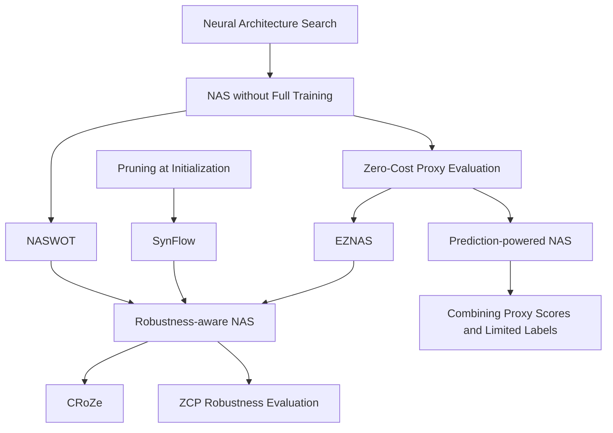
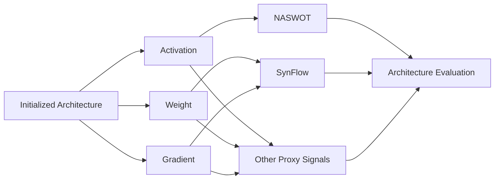

# naswot-eznas-synflow-nb
> Notebook này để ghi chép lại quá trình tìm hiểu 3 Paper: EZNAS, NASWOT, SynFlow, ...; các nghiên cứu liên quan đến Zero-Cost NAS và các Thư viện liên quan sẽ ứng dụng trong quá trình học và thực hiện. Ngôn ngữ được sử dụng note: Tiếng Việt (Có thể sẽ có phiên bản Tiếng Anh để phục vụ cho việc chuyên sâu ở chuyên ngành). Có một vài phạm trù nằm xa hơn với những kiến thức hiện tại em đã trang bị; chính vì thế, thời gian tìm hiểu của em tương đối lâu và phải nhờ AI trong việc hỗ trợ các vấn đề về code, thuật toán.
> Các paper đã được đính kèm tại /src/papers/... với các mã paper đính kèm - phục vụ cho quá trình đọc và học hỏi từ các paper.
## Tiếp cận
Định hướng tiếp cận của em đối với 3 paper này để hiểu chủ yếu về các quy trình: Bài toán -> lý thuyết -> công thức toán -> thuật toán -> triển khai -> đánh giá. Cụ thể, quy trình của em được diễn ra như sau:
### 1. Ý tưởng bài toán:
- Paper đang giải quyết vấn đề gì?
- Tại sao được nghiên cứu?
- Hạn chế trước của paper ban đầu là gì?
- Ý tưởng cốt lõi mà bài toán đề xuất?
- Outcome của ý tưởng/nghiên cứu đó là gì?
### 2. Lý thuyết toán:
> Do hiện tại, em đang bổ sung - các kiến thức về toán chuyên ngành; nên là em dành khá nhiều thời gian trong việc hiểu và phân tích toán. Do đó, một số phần công thức toán em chỉ dùng các trường hợp thực tế để đưa ra gợi ý và giải thích hoạt động. Em sẽ cố gắng học hỏi thêm sau quá trình này. Các vấn đề được em đặt ra ở cơ sở này bao gồm:
- Khái niệm toán đang dùng?
- Cơ sở hình thành?
- Ý nghĩa phép toán, trực quang hóa hình ảnh?
- Liên hệ giữa các công thức liên quan?
- Biểu thức toán -> Thuật toán?
### 3. Quy trình hoạt động:
- Đầu vào? Đầu ra?
- Khởi tạo gì?
- Cơ sở đầu vào?
- Forward pass/Backward pass thực hiện những gì?
- Score được tính? Đánh giá cấu trúc?
### 4. Triển khai code:
> Chủ yếu, quy trình triển khai code này, em sẽ sừ dụng trên Colab - GPU T4 hoặc máy cá nhân của mình; nên có thể đánh giá trong phạm vi cho phép.
- Cấu trúc code (Đi cùng với thuật toán để đặt đầu ra)?
- Các module, hàm quan trọng được sử dụng trong quá trình phát triển?
- Kích thước và giá trị các biến lẻ tensors?
- Tính chính xác của quá trình tính?
### 5. Đánh giá và nhận xét:
> Em chưa thể có nhiều kết luận đúng cho các phương pháp này, tuy nhiên - các câu hỏi và các vấn đề em thực nghiệm, em sẽ dùng tính các score trên các nền kiến trúc khác nhau; đồng thời là kết luận nhỏ do em rút ra khi quan sát về các điểm mạnh, hạn chế của các phương pháp. Vì vậy, các vấn đề em sẽ đặt ra là:
- Thứ hạng giữa các phương pháp theo score (Có thể xem xét các vấn đề phụ thuộc vào input, batch size, ...)
- Điểm mạnh, hạn chế của các quy trìnhp
- Những vấn đề đặt ra, chưa thể giải quyết?
- Liên quan giữa các nghiên cứu với nhau?
- Đề xuất -> Ở hướng này, em chỉ đặt ra một vấn đề nhỏ, sau khi đã tham khảo qua nhiều paper khác nhau và tìm các cốt lõi cần thiết trong quá trình phát triển.
## Các paper hiện tại em đang nghiên cứu và đọc qua:

| Paper | Năm | Nội dung | Tìm hiểu|
|---|---:|---|---|
| NASWOT | 2021 | activation-based zero-cost architecture scoring | Sử dụng activation overlap và kernel matrix để đánh giá kiến trúc |
| EZNAS | 2022 | evolutionary zero-cost proxy discovery | Cách genetic programming tự động tìm kiếm proxy |
| SynFlow | 2020 | pruning at initialization | synaptic Flow, saliency and iterative pruning |
| ... | ... | ... | ... |

**Neural Architecture Search without Training (NASWOT)**

> arXiv: `2006.04647`;
> Publication: ICML 2021
> Authors: Joseph Mellor, Jack Turner, Amos Storkey, Elliot J. Crowley.
> Paper: https://arxiv.org/abs/2006.04647
> Official code: https://github.com/BayesWatch/nas-without-training

Các nội dung em tập trung tìm hiểu gồm có:

- Activation Patterns 
- Binary Activation Matrix
- Hamming Distance
- Kernel Matrix
- Log-determinant
- Architecture Scoring

**Evolving Zero-Cost Proxies for Neural Architecture Scoring (EZNAS)**

> arXiv: `2209.07413`
> Publication: NeurIPS 2022.
> Authors: Yash Akhauri, J. Pablo Muñoz, Nilesh Jain, Ravi Iyer.
> Paper: https://arxiv.org/abs/2209.07413
> Official code: Do bài này tập trung vào phương pháp đánh giá, nên em chỉ dùng suy luận để định hướng đánh giá paper

Các nội dung em tập trung tìm hiểu gồm có:

- Zero-Cost Proxy Discovery
- Genetic Programming
- Expression Tree
- Tensor Collection
- Mathematical Operators
- Fitness Function
- Kendall's Tau
- Crossover và Mutation
- EZNAS-A
- Generalization across architecture search spaces

**Pruning Neural Networks without Any Data by Iteratively Conserving Synaptic Flow (SynFlow)**

> ArXiv: `2006.05467`
> Publication: NeurIPS 2020.
> Authors: Hidenori Tanaka, Daniel Kunin, Daniel L. K. Yamins, Surya Ganguli.
> Paper: https://arxiv.org/abs/2006.05467
> Official code: https://github.com/ganguli-lab/Synaptic-Flow

Các nội dung em tập trung tìm hiểu gồm có (Bài này là phần tốn thời gian của em nhiều nhất trong quá trình làm):

- Network Pruning.
- Pruning at Initialization.
- Weight Linearization.
- Synaptic Flow.
- Gradient-based Saliency.
- Iterative Pruning.
- Layer Collapse.
- Data-free Scoring.

**Ngoài ra, còn có một số paper liên quan mà em đọc qua bao gồm**

> Đây là các paper liên quan trong quá trình nghiên cứu 3 paper được giao; nên em không đi sâu vào chi tiết các paper - chỉ nắm các phần chính cho các paper mà em đang nghiên cứu. 

| Paper | Năm | Liên quan | Các phần liên quan |
|---|---|---|---|
| Zero-Cost Proxies for Lightweight NAS | 2021 | Proxy evaluation | SNIP, GraSP, SynFlow và cách đánh giá các proxy |
| NAS-Bench-Suite-Zero | 2022 | Benchmark | Đánh giá nhiều ZCP trên nhiều tquan |
| Neural Architecture Design and Robustness: A Dataset | 2023 | Robustness benchmark | Architecture-level robustness evaluation |
| CRoZe | 2023 | Robustness-aware ZCP | Feature, parameter và gradient consistency *(Đây là 1/2 paper em quan tâm nhiều nhất khi tìm hiểu các paper liên quan)*|
| An Evaluation of Zero-Cost Proxies | 2025 | Robustness prediction | Khả năng dự đoán robustness bằng nhiều proxy |
| Zero-Cost Proxy for Adversarial Robustness Evaluation | 2025 | Adversarial robustness | Proxy chuyên biệt cho adversarial robustness |
| TRNAS | 2025 | Training-free robust NAS | Training-free adversarial robust architecture search |
| Prediction-powered Neural Architecture Search | 2026 | Proxy-assisted NAS | Kết hợp ZCP với một lượng ground-truth architecture labels hạn chế *(Đây là 2/2 paper em quan tâm nhiều nhất khi tìm hiểu các paper liên quan)* |

**Các paper em đính kèm (/src/papers/*)**
| File PDF | Paper | Liên quan |
|---|---|---|
| `2006.04647v3.pdf` | NASWOT | Paper chính |
| `2209.07413v3.pdf` | EZNAS | Paper chính |
| `2006.05467v3.pdf` | SynFlow | Paper chính|
| `2306.05031v2.pdf` | CRoZe | Paper liên quan |
| `2610.01317v1.pdf` | Prediction-powered NAS | Paper liên quan |
| `2608.19472v3.pdf` | SynFlow: A Multidimensional Diachronic Semantic Analysis Toolkit | Paper chính|

## Kiến thức trong các paper:
**Các paper được phát triển như sau**

**Các tiêu chí tương quan, em đánh giá các yếu tố như sau**

| Tiêu chí | NASWOT | SynFlow | EZNAS |
|---|---|---|---|
| Ý tưởng chính | Activation overlap | Synaptic flow | Evolutionary proxy discovery |
| Thông tin chính | Activation | Weight và gradient | Network statistics |
| Dữ liệu thật | Có | Không | Tùy tensor/biểu thức |
| Nhãn | Không cần | Không cần | Ground truth cần cho discovery fitness |
| Forward Pass | Có | Có | Tùy biểu thức |
| Backward Pass | Không | Có | Tùy biểu thức |
| Full Training | Không | Không | Không cần cho scoring kiến trúc mới |
| Đầu ra | Scalar score | Weight saliency / aggregate score | Proxy expression |
| Mục tiêu gốc | Performance prediction | Pruning at initialization | Performance prediction |
| Chi phí nổi bật | Kernel computation | Gradient và pruning iterations | Genetic Programming discovery |

**Các link signal giữa paper**

## Dataset & Benchmark
> Hiện tại, em đang kết hợp tìm hiểu một vài kiến thức liên quan đến cv, nên hiện tại, em sử dụng các dataset liên quan đến cifar-100 và bench mark nas-bench-201 trong quá trình thực hiện.

| Dataset / Benchmark | Mục đích |
|---|---|
| CIFAR-10 | Kiểm tra pipeline phân loại và clean performance |
| CIFAR-100 | Đánh giá trên dataset có nhiều lớp hơn |
| CIFAR-10-C | Common-corruption robustness |
| CIFAR-100-C | Common-corruption robustness |
| NAS-Bench-201 | Architecture search space và performance labels |
| NAS-Bench-Suite-Zero | So sánh các zero-cost proxies |

## Các tài liệu và notebook em đã thực hiện

> Trong quá trình tìm hiểu ba paper EZNAS, NASWOT và SynFlow, em xây dựng các tài liệu Markdown để ghi lại quá trình học, phân tích và hệ thống hóa kiến thức của mình.
> Các tài liệu được em viết với mục tiêu tự học của bản thân, hiểu những gì mình đang làm. Trong đây, em có sử dụng AI để hiểu rõ các thuật toán, code và tiện cho quá trình tìm hiểu các paper liên quan!
| Phương pháp | File tài liệu | Nội dung chính |
|---|---|---|
| **EZNAS** | [`docs/EZNAS.md`](docs/EZNAS.md) | Zero-Cost Proxy Discovery, Genetic Programming, Expression Tree, Tensor Collection, Fitness Function, Crossover, Mutation và EZNAS-A. |
| **NASWOT** | [`docs/NASWOT.md`](docs/NASWOT.md) | Activation Patterns, Binary Activation Matrix, Hamming Distance, Kernel Matrix, Log-determinant và Architecture Scoring. |
| **SynFlow** | [`docs/SynFLow.md`](docs/SynFLow.md) | Network Pruning, Pruning at Initialization, Weight Linearization, Synaptic Flow, Gradient-based Saliency, Iterative Pruning và Layer Collapse. |
| **Zero-Cost Proxy Lab** | [`notebooks/01_zero_cost_proxy_colab_lab.ipynb`](notebooks/01_zero_cost_proxy_colab_lab.ipynb) | Triển khai NASWOT, SynFlow cùng các thành phần liên quan. |
| **Proxy Implementation** | [`src/zero_cost_metrics.py`](src/zero_cost_metrics.py) | Tách các thuật toán liên quan thành hàm. |
| **Unit Tests** | [`tests/test_zero_cost_metrics.py`](tests/test_zero_cost_metrics.py) | Kiểm tra các thàmh phần liên quan. |
| **Experimental Guide** | [`docs/COLAB_LAB.md`](docs/COLAB_LAB.md) | Note colab_lab của mình. |
