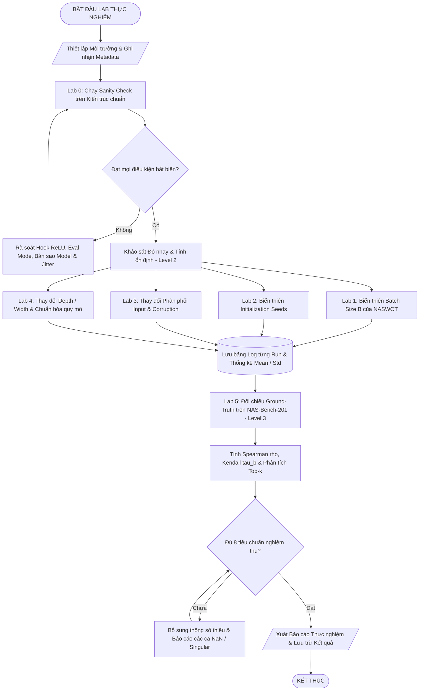

# Experimental Lab - NASWOT, SynFlow & EZNAS

> Câu hỏi đi xuyên suốt phần thực nghiệm có thể xem là: Làm thế nào để chuyển các biểu thức toán học của NASWOT, SynFlow và EZNAS thành một quy trình đo đạc chặt chẽ, phân biệt rạch ròi giữa việc tính ra được một con số vô hướng với việc tái lập đúng thuật toán và kiểm chứng khả năng xếp hạng kiến trúc thực tế?

**Thông tin khung thực nghiệm**

| Các mục | Thông tin |
| --- | --- |
| Các phương pháp đối chiếu | NASWOT (ICML 2021), SynFlow (NeurIPS 2020), EZNAS (NeurIPS 2022) |
| Môi trường thực thi | Google Colab (T4 GPU / CPU) và máy cá nhân Ubuntu (RAM 8 GB) |
| Dữ liệu khảo sát | CIFAR-10, CIFAR-100 (mở rộng sang CIFAR-10-C, CIFAR-100-C) |
| Không gian kiểm chứng | Các kiến trúc CNN thử nghiệm và NAS-Bench-201 |
| Mã nguồn NASWOT gốc | [BayesWatch/nas-without-training](https://github.com/BayesWatch/nas-without-training) |
| Mã nguồn SynFlow gốc | [ganguli-lab/Synaptic-Flow](https://github.com/ganguli-lab/Synaptic-Flow) |
| Mã nguồn EZNAS gốc | [IntelLabs/Hardware-Aware-Automated-Machine-Learning - EZNAS](https://github.com/IntelLabs/Hardware-Aware-Automated-Machine-Learning/tree/main/EZNAS) |

**Ba cấp độ triển khai**

> Ban đầu, sau khi đọc và ghi chép xong phần lý thuyết của cả ba paper, em muốn chuyển ngay các biểu thức toán học thành một pipeline chạy được để lấy bảng kết quả; nhưng khi bắt tay vào thiết kế thực nghiệm, em nhận ra cần phải tách quá trình này thành ba mức độ hoàn toàn khác nhau để không đánh đồng việc tính ra một con số với việc đã reproduce thành công paper hay chứng minh được proxy đó dự đoán tốt.

| Mức độ | Câu hỏi cần trả lời | Kết quả cần thu được |
| --- | --- | --- |
| Level 1 - Implementation check | Pipeline có tính đúng tín hiệu trung gian và công thức mà em đang mô tả không? | Tensor shape, kernel matrix, gradient, scalar score và các bài kiểm tra sanity check |
| Level 2 - Experimental comparison | Điểm số có ổn định khi thay đổi mini-batch, random seed, dataset và quy mô architecture không? | Bảng kết quả qua nhiều lần chạy, mean, standard deviation và biến thiên thứ hạng |
| Level 3 - Benchmark validation | Proxy có thực sự tương quan với validation accuracy hoặc robustness sau training không? | Hệ số Spearman's $\rho$, Kendall's $\tau_b$ và phân tích nhóm top-k architectures |

> Một lần chạy xuất ra được scalar score mới chỉ chứng minh pipeline không bị lỗi thực thi để trả về kết quả. Con số đơn lẻ đó chưa chứng minh được proxy có ý nghĩa dự đoán thứ hạng, và càng chưa chứng minh implementation đã khớp hoàn toàn với thiết lập gốc trong paper.

**Phạm vi triển khai của ba phương pháp**

> Khi đặt ba phương pháp vào cùng một quy trình thực nghiệm tại thời điểm initialization, mỗi hướng tiếp cận đòi hỏi cách can thiệp vào forward pass, backward pass và quản lý trạng thái của mạng rất khác nhau.

* Đối với NASWOT (activation-based scoring): Tại thời điểm initialization, một mini-batch ảnh được đưa qua mạng và sử dụng cơ chế hook trên các ReLU units để ghi nhận trạng thái active hoặc inactive, hoàn toàn không dùng đến ground-truth label. Một giới hạn kỹ thuật phải kiểm soát chặt là cơ chế hook theo module chỉ bắt được các tầng khởi tạo dưới dạng đối tượng ReLU độc lập; nếu kiến trúc gọi hàm kích hoạt trực tiếp dưới dạng functional trong luồng truyền xuôi, bộ thu thập sẽ bỏ sót toàn bộ activation patterns trừ khi chuyển kiến trúc về dạng module-based hoặc can thiệp trực tiếp vào đồ thị tính toán.
* Đối với SynFlow (one-pass scoring và iterative pruning): Cần tách bạch hai bài toán khác nhau. Khi dùng SynFlow làm zero-cost architecture proxy, ta chỉ thực hiện one-pass scoring - tức tính synaptic saliency một lần duy nhất tại initialization rồi cộng tổng qua toàn bộ tham số để lấy một scalar score xếp hạng mạng. Ngược lại, thuật toán pruning gốc trong paper là iterative pruning gồm $100$ vòng lặp cập nhật binary mask theo lịch hàm mũ; các bài kiểm tra nhanh với $5$ vòng lặp chỉ đóng vai trò smoke test để xác nhận logic cắt tỉa trên mạng nhỏ chứ không phải thiết lập reproduction của paper. Để việc tính SynFlow không làm hỏng trọng số khởi tạo $\theta_0$ khi chạy chung với NASWOT, quy trình phải tạo một bản sao độc lập của mạng, lấy trị tuyệt đối tham số, chuyển sang evaluation mode (nhằm ngăn các tầng BatchNorm cập nhật hoặc dùng sai running statistics chưa học), truyền synthetic input toàn số $1$ và lan truyền ngược từ tổng đầu ra.
* Đối với EZNAS (discovery và scoring): Không thể gộp giai đoạn tiến hóa tìm công thức (discovery) và giai đoạn chấm điểm kiến trúc mới (scoring) làm một. Muốn tái lập giai đoạn discovery của EZNAS, hệ thống bắt buộc phải xây dựng đầy đủ quy trình nhận diện khối RCB, trích xuất đúng $22$ tensor statistics dưới ba loại đầu vào $\mathcal{D}, \mathcal{N}, \mathcal{P}$, cài đặt đủ $34$ mathematical operators, biểu diễn expression tree kèm bước lọc lỗi, và tối ưu hàm fitness dựa trên Kendall's Tau qua các evolution tasks. Với giới hạn tài nguyên của Google Colab T4 hoặc máy cá nhân, phạm vi khả thi là thực hành trích xuất các tensor trung gian hoặc kiểm thử giai đoạn scoring trên một biểu thức cho trước; việc tự chọn một công thức đơn giản tính trên tensor $T3G_N$ chỉ là bài tập kiểm tra luồng dữ liệu, hoàn toàn không đồng nghĩa với proxy EZNAS-A hay toàn bộ framework EZNAS.

## Lý thuyết & Kiểm soát biến số

**Thiết lập môi trường và tài nguyên tính toán**

> Một kết quả thực nghiệm chỉ có giá trị đối chiếu khi mọi thông số về phần cứng, phiên bản thư viện và cách chia dữ liệu được cố định rõ ràng ngay từ đầu.

* Trên môi trường Google Colab: Ưu tiên sử dụng T4 GPU runtime nếu khả dụng, hoặc chuyển về CPU với mini-batch nhỏ để kiểm tra logic. Cần giữ nguyên phiên bản PyTorch và Torchvision mặc định của môi trường trừ khi phát sinh xung đột rõ ràng, đồng thời thực thi từng bước từ khâu nạp dữ liệu, khởi tạo mạng cho đến bước tính score thay vì chạy tự động toàn bộ luồng khi chưa kiểm tra trạng thái trung gian.
* Trên môi trường Ubuntu cục bộ (RAM 8 GB): Bắt đầu trên CPU với các kiến trúc CNN nhỏ để tránh tràn bộ nhớ. Khi đo NASWOT, giữ kích thước mini-batch trong khoảng từ $8$ đến $32$ mẫu và tắt đa luồng nạp dữ liệu nếu gặp nghẽn bộ nhớ. Riêng với SynFlow, do đầu vào chỉ là một synthetic tensor toàn số $1$ có kích thước batch bằng $1$, bộ nhớ tiêu thụ rất nhẹ và không đòi hỏi lưu trữ batch ảnh lớn trên thiết bị.

Các thông tin metadata bắt buộc phải lưu lại trong mỗi lần chạy:

| Nhóm thông tin | Nội dung cần ghi nhận cụ thể |
| --- | --- |
| Môi trường phần mềm | Phiên bản Python, PyTorch và Torchvision |
| Phần cứng thực thi | Tên cụ thể của CPU hoặc GPU, phiên bản CUDA runtime |
| Dữ liệu đầu vào | Tên dataset (CIFAR-10, CIFAR-100), tập train hay validation, phép chuẩn hóa và augmentation |
| Cấu hình lấy mẫu | Kích thước mini-batch $B$ và danh sách chỉ số mẫu (batch indices) chính xác đã đưa vào mạng |
| Khởi tạo kiến trúc | Định danh cấu hình mạng (architecture config) và giá trị random seed |
| Thiết lập số học | Độ chính xác dấu phẩy động (float32 hay float64) và hệ số làm trơn jitter $\epsilon$ của NASWOT |
| Chi phí thực thi | Thời gian chạy (runtime) cho từng proxy và mức tiêu thụ bộ nhớ đỉnh (peak memory) |

**Các hiện tượng lỗi và bất ổn định số học cần kiểm soát**
Trong quá trình chuyển từ công thức trên giấy sang tính toán ma trận thực tế, sáu hiện tượng dưới đây rất dễ làm sai lệch kết quả nếu không có cơ chế phát hiện sớm:

| Hiện tượng quan sát được | Nguyên nhân gốc rễ | Cách thức kiểm tra và xử lý |
| --- | --- | --- |
| NASWOT trả về giá trị $-\infty$ | Ma trận kernel $K_H$ bị suy biến (singular) do có các mẫu tạo ra activation pattern trùng nhau hoặc sai số dấu phẩy động làm định thức không dương | Kiểm tra dấu và giá trị log-determinant thô, đếm số hàng trùng nhau trong ma trận $C$, điều chỉnh batch size hoặc cộng thêm jitter $\epsilon I$ có ghi chú rõ ràng |
| Không thu được ma trận kích hoạt $C$ | Kiến trúc mạng dùng phép toán ReLU dưới dạng hàm trực tiếp thay vì khởi tạo thành các tầng module | Duyệt cây cấu trúc mạng để kiểm tra các điểm đặt hook trước khi đưa mini-batch qua mạng |
| SynFlow trả về NaN hoặc Inf | Hiện tượng tràn số (overflow/underflow) khi nhân chuỗi ma trận qua mạng quá sâu hoặc có độ lớn trọng số biến thiên mạnh | Kiểm tra biên độ đầu ra và gradient theo từng tầng; chuyển sang độ chính xác float64 khi thử nghiệm trên mạng sâu |
| Điểm SynFlow tăng vọt khi tăng chiều rộng mạng | Tổng synaptic saliency phụ thuộc trực tiếp vào số lượng tham số và số lượng đường truyền qua các tầng | Ghi nhận song song tổng số tham số của mạng và tách riêng các cột phân tích có chuẩn hóa theo quy mô tham số |
| Thứ hạng thay đổi mạnh giữa các lần chạy | Độ nhạy cao với trọng số khởi tạo $\theta_0$ hoặc do thứ tự mẫu trong mini-batch bị xáo trộn giữa các lần đo | Cố định đồng thời cả random seed khởi tạo mạng lẫn chỉ số batch indices của dữ liệu đầu vào |
| Tràn bộ nhớ RAM hoặc GPU | Kích thước mini-batch quá lớn, lưu toàn bộ tensor trung gian hoặc giữ lại đồ thị đạo hàm sau khi tính xong | Giảm batch size, chuyển ngay activation sang dạng nhị phân gọn nhẹ và giải phóng bộ nhớ đệm sau mỗi kiến trúc |

## Công thức & Thước đo thực nghiệm

> Để việc tính toán trên máy tính khớp với lý thuyết và không bị sập bởi sai số dấu phẩy động, các biểu thức của NASWOT và SynFlow cần được viết lại dưới dạng đại số ma trận trực tiếp, đi kèm các thước đo thống kê chuẩn để đánh giá chất lượng xếp hạng.

**Biểu diễn ma trận của NASWOT trong thực nghiệm**
Với mini-batch gồm $B$ mẫu đầu vào và tổng cộng $N_A$ vị trí kích hoạt ReLU được làm phẳng trên toàn mạng, gọi $C \in \{0, 1\}^{B \times N_A}$ là ma trận nhị phân mà mỗi hàng biểu diễn activation pattern của một mẫu. Thay vì dùng vòng lặp đếm khoảng cách Hamming cho từng cặp mẫu tốn chi phí $O(B^2 N_A)$ tuần tự, overlap kernel $K_H \in \mathbb{R}^{B \times B}$ được tính trực tiếp bằng phép nhân ma trận:

$$K_H = C C^T + (\mathbf{1} - C)(\mathbf{1} - C)^T.$$

Trong đó $\mathbf{1}$ là ma trận toàn số $1$ cùng kích thước với $C$. Khi ma trận $K_H$ suy biến hoặc gần suy biến, ta xét ma trận đã cộng nhiễu đường chéo $K_\epsilon = K_H + \epsilon I$ (với $\epsilon \geq 0$ được ghi vào metadata) và tính trực tiếp log-determinant thông qua phân rã dấu và độ lớn để tránh tràn số:

$$\boxed{ s_{\mathrm{NASWOT}} = \log\left\vert{}\det(K_\epsilon)\right\vert{} } \tag{1}$$

**Biểu diễn One-pass SynFlow và các biến thể phân tích**
Trên bản sao của kiến trúc $A$ đã lấy trị tuyệt đối tham số $\vert{}W^{[l]}\vert{}$ và đặt ở trạng thái evaluation mode với đầu vào $\mathbf{1}$, điểm số toàn cục trong bài toán one-pass scoring được tổng hợp từ độ lớn của tích đạo hàm và tham số:

$$\mathcal{R}_{\mathrm{SF}} = \mathbf{1}^T \left( \prod_{l=1}^{L} \vert{}W^{[l]}\vert{} \right) \mathbf{1}, \qquad \boxed{ s_{\mathrm{SynFlow}}(A) = \sum_{w \in \theta_A} \left\vert{} \frac{\partial \mathcal{R}_{\mathrm{SF}}}{\partial w} \cdot w \right\vert{} } \tag{2}$$

Vì $s_{\mathrm{SynFlow}}(A)$ tăng rất nhanh theo số lượng tham số $\vert{}\theta_A\vert{}$ và chiều sâu $L$, trong quá trình khảo sát thực nghiệm (như ở Lab 4), em có thể tính thêm hai đại lượng biến thể để quan sát ảnh hưởng của quy mô mạng:

$$\tilde{s}_{\mathrm{norm}}(A) = \frac{s_{\mathrm{SynFlow}}(A)}{\vert{}\theta_A\vert{}}, \qquad \tilde{s}_{\mathrm{log}}(A) = \log\big(1 + s_{\mathrm{SynFlow}}(A)\big).$$

*(Lưu ý bắt buộc: $\tilde{s}_{\mathrm{norm}}$ và $\tilde{s}_{\mathrm{log}}$ chỉ là các biến thể phân tích do em tự đề xuất để kiểm tra độ lệch quy mô tham số, tuyệt đối không dùng để thay thế công thức SynFlow gốc khi đối chiếu với kết quả trong paper).*

**Các thước đo đánh giá chất lượng xếp hạng (Ground-truth Metrics)**
Khi đối chiếu vector điểm proxy $\mathbf{s} = [s(A_1), \ldots, s(A_n)]$ với vector độ chính xác thực tế sau huấn luyện $\mathbf{a} = [\mathrm{Acc}(A_1), \ldots, \mathrm{Acc}(A_n)]$ trên $n$ kiến trúc:

1. Hệ số tương quan hạng Spearman ($\rho$): Đo lường mối quan hệ đơn điệu giữa thứ hạng theo proxy $\mathrm{rg}(\mathbf{s})$ và thứ hạng thực tế $\mathrm{rg}(\mathbf{a})$ thông qua hiệp phương sai và độ lệch chuẩn của thứ hạng:

$$\boxed{\rho = \frac{\mathrm{cov}\big(\mathrm{rg}(\mathbf{s}), \mathrm{rg}(\mathbf{a})\big)}{\sigma_{\mathrm{rg}(\mathbf{s})} \sigma_{\mathrm{rg}(\mathbf{a})}}} \tag{3}$$

2. Hệ số tương quan hạng Kendall có hiệu chỉnh đồng hạng ($\tau_b$): Đếm số cặp đồng thuận $C$ và số cặp nghịch đảo $D$ trên tổng số cặp $N_0 = \frac{n(n-1)}{2}$, có trừ đi số cặp đồng hạng theo điểm proxy ($T_s$) và theo accuracy ($T_a$):

$$\boxed{\tau_b = \frac{C - D}{\sqrt{(N_0 - T_s)(N_0 - T_a)}}} \tag{4}$$

Bảng phân nhiệm các thước đo trong báo cáo thực nghiệm:

| Thước đo | Câu hỏi thực nghiệm tương ứng | Nguyên tắc diễn giải kết quả |
| --- | --- | --- |
| Spearman's $\rho$ | Hai bảng xếp hạng có biến thiên đơn điệu cùng chiều hay không? | Phản ánh xu hướng toàn cục, không đòi hỏi quan hệ tuyến tính giữa điểm số và accuracy |
| Kendall's $\tau_b$ | Xác suất hai kiến trúc bất kỳ được xếp đúng thứ tự hơn kém là bao nhiêu? | Xử lý chính xác các trường hợp nhiều kiến trúc có điểm số trùng nhau (ties) |
| Top-k overlap / Recall | Proxy có giữ lại được các kiến trúc nằm trong nhóm xuất sắc nhất (top $5\%$, top $10\%$) không? | Phải định nghĩa rõ ngưỡng $k$ hoặc phân vị trước khi tính tỷ lệ giao nhau |
| Mean $\pm$ Std qua các seeds | Điểm số và thứ hạng có bị dao động mạnh khi thay đổi trọng số khởi tạo $\theta_0$ không? | Chỉ phản ánh độ ổn định nội tại của proxy, không thể dùng để thay thế cho tương quan thứ hạng với accuracy |
| Runtime & Peak Memory | Chi phí tính toán thực tế để chấm điểm một kiến trúc là bao nhiêu? | Chỉ có ý nghĩa khi đo trên cùng một cấu hình phần cứng, batch size và phiên bản thư viện |

## Biến Logic

## Tổng hợp mối liên hệ giữa Lý thuyết và Thực nghiệm:

> Khi đi trọn vẹn từ phần đọc hiểu công thức của NASWOT, SynFlow, EZNAS sang việc tự tay thiết kế từng bài lab kiểm chứng, em rút ra được ba góc nhìn thực tế giúp nối liền khoảng cách giữa bài báo khoa học và hệ thống chạy thật:

* Giữa công thức đại số và tính toán dấu phẩy động luôn có một khoảng cách: Trên lý thuyết, kernel matrix $K_H$ của NASWOT là ma trận xác định nửa dương và $\mathcal{R}_{\mathrm{SF}}$ của SynFlow là một đa thức dương thuần nhất; nhưng khi đưa vào máy tính với độ chính xác hữu hạn, $K_H$ rất dễ rơi vào trạng thái suy biến làm định thức bằng $0$, còn tích chuỗi ma trận của SynFlow qua mạng sâu dễ gây tràn số dẫn tới vô cực. Việc theo dõi sát các trường hợp suy biến, kiểm soát chế độ của tầng BatchNorm và ghi nhận minh bạch hệ số jitter $\epsilon$ chính là ranh giới giữa một thực nghiệm đáng tin cậy và một con số ngẫu nhiên.
* Bản chất của tín hiệu đầu vào quyết định hoàn toàn hành vi của proxy trong thực nghiệm: Vì NASWOT quan sát cách mạng chia cắt không gian dữ liệu thông qua binary activation patterns, điểm số của nó nhạy cảm trực tiếp với kích thước mini-batch $B$ và sự dịch chuyển phân phối ảnh (từ ảnh sạch sang ảnh nhiễu). Ngược lại, vì SynFlow đo lường độ thông suốt của luồng trọng số dưới vector toàn số $1$, nó miễn nhiễm với biến động của dữ liệu nhưng lại chịu ảnh hưởng mạnh bởi quy mô tham số và chiều sâu kiến trúc.
* Ranh giới giữa sử dụng công cụ và tái lập nghiên cứu: Việc tính được một điểm số trong vài giây ở giai đoạn scoring rất hữu ích để xếp hạng nhanh các ứng viên, nhưng để thực sự làm chủ các phương pháp như Iterative SynFlow Pruning ($100$ vòng lặp) hay EZNAS Discovery (tiến hóa cây biểu thức trên $22$ tensor statistics của khối RCB), người làm thực nghiệm phải kiểm soát toàn bộ quy trình từ khâu thu thập thống kê, chống học vẹt trên tập tiến hóa cho đến bước kiểm chứng tương quan thứ hạng độc lập trên các benchmark chuẩn.