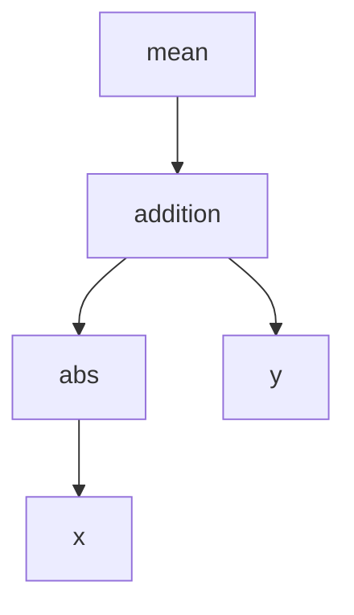
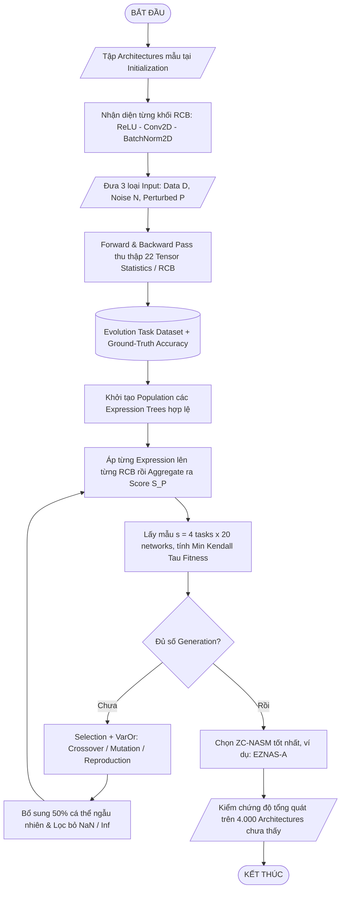

# EZNAS

**Thông tin paper**

| Các mục | Thông tin |
|---|---|
| Tên gốc | *EZNAS: Evolving Zero-Cost Proxies for Neural Architecture Scoring* |
| Tác giả | Yash Akhauri, J. Pablo Muñoz, Nilesh Jain, Ravishankar Iyer |
| Năm / Hội nghị | 2022 - NeurIPS 2022 |
| DOI | [10.52202/068431-2208](https://doi.org/10.52202/068431-2208) |
| arXiv | [2209.07413](https://arxiv.org/abs/2209.07413) |
| Paper chính thức | [NeurIPS proceedings](https://papers.nips.cc/paper_files/paper/2022/hash/c474dc287c6de27fec2981f812c361e1-Abstract-Conference.html) |
| PDF | [NeurIPS PDF](https://papers.nips.cc/paper_files/paper/2022/file/c474dc287c6de27fec2981f812c361e1-Paper-Conference.pdf) |
| Mã nguồn | [IntelLabs/Hardware-Aware-Automated-Machine-Learning - EZNAS](https://github.com/IntelLabs/Hardware-Aware-Automated-Machine-Learning/tree/main/EZNAS) |

**Zero-Cost Proxy**
> Trong NAS, khi một neural được hình thành - Các quá trình đó thường đi kèm với nhiều các tập architecture liên quan, với mỗi tập architecture sẽ kết hợp cùng nhiều neural khác nhau. Khi xét các rất nhiều các tập neural architecture đó, để nhận xét các architecture nào có tiềm năng tốt thì: Cách trực tiếp là training từng mạng sau đó đo validation acc -> Với những mạng lớn thì gây tốn nhiều chi phí vì nhiều kiến trúc khác nhau.

Zero-cost proxy được xem là chỉ số tính trên network ở trạng thái thô (Chưa được training đầy đủ), tất cả dùng để ước lượng và sắp xếp lần lượt các architecture - định nghĩa của zero cost hoàn toàn để tránh các chi phí training lớn trên từng mạng nhỏ. Trong đó, khi tạo các scalar score:

$$
S(A, \theta_0,X),
$$

Trong đó:
- $A$: architecture;
- $\theta_0$: Tham số tại thời điểm bắt đầu;
- $X$: input batch của proxy;
- $S$: score được tính trước khi quá trình training bắt đầu.

Khi đó, score có thể được track bằng cách so sánh với acc thật và các architecture sau của mô hình.

> Theo approach từ paper, em nhận thấy như sau: Trước eznaseznas, nhiều proxy đều được thiết kế dựa trên việc nhìn nhận hoặc quá trình training, tracking thủ công; có thể xem:
- NASWOT track các overlap giữa các patterns,
- SynFlow khai thác các synaptic sal,
- SNIP, GraSP, ... track các gradient theo nhiều hướng.

Chính vì thế, tác giả đặt ra câu hỏi: Thay vì để tự con người nghĩ ra công thức - liệu có thể cho thuật toán tự đề xuất các biểu thức toán từ các thống kê của neural network? - Quy định các biểu thức đó, sẽ xếp hạng các architecture thật gần với các accuracy thật của model?

**Các vấn đề được đề cập**

| Phương pháp | Mục tiêu |
|---|---|
| ZC-NASM | Tạo score cho architecture |
| EZNAS | Framework dùng Genetic Programming để tìm kiếm từ  ZC-NASM |
| EZNAS-A | Một proxy cụ thể trong paper |
| EZNAS-B | Một proxy khác trong paper |
| Discovery | Tìm kiếm biểu thức proxy |
| Application / Scoring | Áp dụng biểu thức đã tìm được lên architecture mới |

**Genetic Programming**

> Nếu đặt mình vào vị trí người đi tìm công thức chấm điểm mạng neural, em có trong tay rất nhiều "nguyên liệu" thô: trọng số (weights), giá trị kích hoạt (activations), đạo hàm (gradients) dưới nhiều loại đầu vào khác nhau, cùng hàng chục phép toán kết hợp chúng lại. Vì số lượng tổ hợp công thức là quá lớn để con người tự ngồi thử từng cái, EZNAS giao việc "sáng tác công thức" này cho thuật toán tiến hóa.

Thay vì dùng giải thuật di truyền để tiến hóa trực tiếp trọng số hay cấu trúc mạng, EZNAS dùng Genetic Programming (GP) để tiến hóa chính biểu thức toán học làm nhiệm vụ chấm điểm kiến trúc (gọi là ZC-NASM). Quy trình này vận hành giống như chọn lọc tự nhiên trên một quần thể các công thức:

* Population & Individual: Khởi tạo một quần thể gồm nhiều công thức ứng viên; mỗi cá thể là một chương trình được biểu diễn dưới dạng cây biểu thức (*expression tree*).
* Fitness: Đánh giá độ tốt của từng công thức bằng cách cho nó chấm điểm một tập các kiến trúc mạng, rồi đo độ tương quan thứ hạng (Kendall's Tau) với validation accuracy thật của các mạng đó.
* Selection, Crossover, Mutation & Reproduction: Giữ lại những công thức xếp hạng đúng nhất, cho "lai ghép" (*crossover* - trao đổi nhánh công thức giữa hai cây) hoặc "đột biến" (*mutation* - thay đổi ngẫu nhiên một phép toán/biến đầu vào) thông qua cơ chế `VarOr` (thư viện DEAP) để sinh ra thế hệ công thức mới tốt hơn.

> Xem: EZNAS là toàn bộ framework tiến hóa để đi tìm công thức, còn EZNAS-A (hay EZNAS-B) chỉ là một công thức proxy cụ thể được framework đó tìm ra sau quá trình chạy.

## Lý thuyết
**Expression Tree**

> Ban đầu, tác giả từng thử biểu diễn mỗi công thức dưới dạng một chuỗi lệnh tuần tự kèm bộ nhớ tạm (instruction + memory), nhưng cách đó làm chương trình phình to và sinh ra rất nhiều dòng lệnh thừa không đóng góp vào kết quả cuối. Chuyển sang cấu trúc cây biểu thức giúp giải quyết triệt để vấn đề này: mọi nút trên cây đều nằm trên đường truyền tính toán dẫn về gốc. [1, Sec. 3.1; Appendix 8.2]

Một expression tree biểu diễn công thức toán học theo cấu trúc phân cấp:

* Node lá: Các tensor thống kê thu thập từ mạng neural (đầu vào của công thức).
* Node trung gian: Một trong $34$ toán tử toán học được định nghĩa trong không gian tìm kiếm (gồm các phép toán cơ bản như cộng, nhân; phép biến đổi tensor như trị tuyệt đối `abs`, lũy thừa, chuẩn hóa, ReLU, sign, Heaviside, nghịch đảo; phép tính chuẩn/ma trận như Frobenius norm, determinant; và các phép đo tương đồng như cosine similarity, Hamming distance). [1, Sec. 3.3]
* Node gốc: Nơi xuất ra kết quả cuối cùng của biểu thức trên một khối mạng.

Ví dụ với biểu thức đồ chơi $f(x,y) = \mathrm{mean}(\vert{}x\vert{} + y)$, cấu trúc cây được mô tả như sau:

**Thu thập 22 Tensor Statistics trên từng khối RCB**

> Genetic Programming không thể tự nhìn vào một đồ thị kiến trúc trừu tượng để tính toán; nó cần những con số cụ thể phản ánh trạng thái của mạng ngay tại thời điểm khởi tạo ($\theta_0$). Vấn đề là một mạng sâu có hàng trăm lớp, nếu đưa toàn bộ tensor của mọi lớp vào chung một cây biểu thức thì số lượng biến đầu vào sẽ bùng nổ.

Để chuẩn hóa cách lấy dữ liệu, tác giả xác định các cụm cấu trúc cơ sở trong mạng có dạng ReLU $\rightarrow$ Conv2D $\rightarrow$ BatchNorm2D, gọi tắt là một RCB instance. Nếu một kiến trúc có hơn $100$ khối RCB và mỗi khối trích xuất $22$ tensor, việc gom tất cả vào một cây sẽ cần tới khoảng $2.200$ node lá đầu vào. Do đó, EZNAS thiết kế cây biểu thức chỉ nhận đúng $22$ terminals của một khối RCB, rồi áp dụng lặp lại cùng một cây đó lên từng khối RCB trong toàn mạng. [1, Sec. 3.4]

Để công thức tìm được có thể khai thác cả phản ứng với dữ liệu thật lẫn đặc trưng cấu trúc khi gặp nhiễu, tại mỗi khối RCB ở thời điểm khởi tạo, mạng được cho chạy qua ba loại input:

| Ký hiệu | Loại đầu vào | Ý nghĩa vật lý khi đưa qua mạng |
| --- | --- | --- |
| $\mathcal{D}$ | Mini-batch dữ liệu thật | Đo phản ứng của trọng số, activation và gradient trước phân phối ảnh thực tế |
| $\mathcal{N}$ | Random noisy tensor | Đo khả năng truyền tín hiệu và độ nhạy cấu trúc thuần túy khi đầu vào là nhiễu ngẫu nhiên |
| $\mathcal{P}$ | Perturbed data batch | Đo độ ổn định của biểu diễn khi dữ liệu thật bị cộng thêm nhiễu |

Từ $4$ vị trí trích xuất trong khối RCB ($T1, T2, T3, T4$) kết hợp với $3$ loại đầu vào $\{\mathcal{D}, \mathcal{N}, \mathcal{P}\}$ ở cả hai chiều Forward (giá trị tensor) và Backward (gradient, ký hiệu thêm hậu tố $G$), ta thu được tổng cộng:

$$\underbrace{3}_{T1_{\{D,N,P\}}} + \underbrace{3}_{T2_{\{D,N,P\}}} + \underbrace{1}_{T3} + \underbrace{3}_{T4_{\{D,N,P\}}} + \underbrace{3}_{T1G_{\{D,N,P\}}} + \underbrace{3}_{T2G_{\{D,N,P\}}} + \underbrace{3}_{T3G_{\{D,N,P\}}} + \underbrace{3}_{T4G_{\{D,N,P\}}} = 22 \text{ tensors}.$$

Trong đó:

* $T3$: Trọng số của lớp tích chập (Conv2D weights) - chỉ có $1$ tensor duy nhất vì trọng số tại thời điểm khởi tạo $\theta_0$ không thay đổi theo loại dữ liệu đầu vào;
* $T3G_D, T3G_N, T3G_P$: Gradient của trọng số Conv2D khi chạy backward với dữ liệu thật $\mathcal{D}$, nhiễu $\mathcal{N}$ và dữ liệu nhiễu $\mathcal{P}$;
* $T4_{\{D,N,P\}}$ và $T4G_{\{D,N,P\}}$: Các tensor activation và gradient của activation tương ứng. [1, Sec. 3.2; Figs. 1-2]
*(Lưu ý: Với các tensor trung gian $T1, T2$, giữ nguyên ký hiệu gốc của paper để đảm bảo tính chính xác khi đối chiếu với sơ đồ Figure 1-2 và mã nguồn chính thức).*
* Việc cung cấp đồng thời cả dữ liệu thật ($\mathcal{D}$) lẫn nhiễu ($\mathcal{N}, \mathcal{P}$) giúp thuật toán tiến hóa tự quyết định xem tín hiệu phụ thuộc dữ liệu hay tín hiệu cấu trúc thuần túy mới là yếu tố dự báo tốt hơn cho khả năng học của mạng.
* Vì cây biểu thức chỉ tính toán cục bộ bên trong từng khối RCB rồi mới gom điểm lại, cách biểu diễn này không trực tiếp nắm bắt được cấu trúc kết nối toàn cục (*global connectivity*) giữa các nhánh xa nhau trong mạng, và sẽ cần điều chỉnh lại pipeline nếu áp dụng cho các kiến trúc không tuân theo mẫu khối RCB. [1, Sec. 6]

**Đo độ tương quan thứ hạng bằng Kendall's Tau**
Vì mục tiêu của một proxy trong NAS là sắp xếp đúng thứ tự từ kiến trúc tệ đến kiến trúc tốt, EZNAS dùng hệ số tương quan hạng Kendall's Tau ($\tau$) làm hàm đánh giá độ thích nghi (*fitness*).

Xét $n$ kiến trúc mạng được đem ra đánh giá. Với mọi cặp hai kiến trúc $(A_i, A_j)$ bất kỳ ($i \neq j$), ta so sánh thứ tự điểm proxy $S_P$ với thứ tự độ chính xác thật $\mathrm{Acc}$:

* Cặp $(A_i, A_j)$ gọi là concordant - $C$ nếu proxy và thực tế xếp hạng giống nhau: tức là $(S_P(A_i) - S_P(A_j)) \cdot (\mathrm{Acc}(A_i) - \mathrm{Acc}(A_j)) \gt 0$.
* Cặp $(A_i, A_j)$ gọi là discordant - $D$ nếu proxy xếp hạng ngược với thực tế: tức là $(S_P(A_i) - S_P(A_j)) \cdot (\mathrm{Acc}(A_i) - \mathrm{Acc}(A_j)) \lt 0$.

Khi không có các cặp đồng hạng (*ties*), Kendall's Tau được định nghĩa:

$$\tau = \frac{C - D}{\binom{n}{2}} = \frac{C - D}{\frac{n(n-1)}{2}}, \qquad \tau \in [-1, 1].$$

*(Trong thực nghiệm khi nhiều kiến trúc cho ra cùng một điểm số dẫn đến đồng hạng, thư viện tính toán như `scipy.stats.kendalltau` sẽ sử dụng biến thể chuẩn hóa có hiệu chỉnh ties ở mẫu số).*

**Ví dụ tính bằng tay**
Giả sử có $n = 4$ kiến trúc $\{A_1, A_2, A_3, A_4\}$ với điểm proxy và accuracy thực tế như sau:

| Kiến trúc | Điểm Proxy $S_P$ | Accuracy thật $\mathrm{Acc}$ | Thứ hạng theo Proxy | Thứ hạng thật |
| --- | --- | --- | --- | --- |
| $A_1$ | 0.9 | 0.92 | 1 | 1 |
| $A_2$ | 0.2 | 0.65 | 4 | 4 |
| $A_3$ | 0.7 | 0.88 | 2 | 2 |
| $A_4$ | 0.4 | 0.71 | 3 | 3 |

Với $n = 4$, tổng số cặp cần so sánh là $\binom{4}{2} = \frac{4 \times 3}{2} = 6$ cặp:

* $(A_1, A_2)$: $0.9 \gt 0.2$ và $0.92 \gt 0.65 \rightarrow$ Đồng thuận ($1$).
* $(A_1, A_3)$: $0.9 \gt 0.7$ và $0.92 \gt 0.88 \rightarrow$ Đồng thuận ($1$).
* $(A_1, A_4)$: $0.9 \gt 0.4$ và $0.92 \gt 0.71 \rightarrow$ Đồng thuận ($1$).
* $(A_2, A_3)$: $0.2 \lt 0.7$ và $0.65 \lt 0.88 \rightarrow$ Đồng thuận ($1$).
* $(A_2, A_4)$: $0.2 \lt 0.4$ và $0.65 \lt 0.71 \rightarrow$ Đồng thuận ($1$).
* $(A_3, A_4)$: $0.7 \gt 0.4$ và $0.88 \gt 0.71 \rightarrow$ Đồng thuận ($1$).

Do đó $C = 6, D = 0 \implies \tau = \frac{6 - 0}{6} = 1.0$ (xếp hạng trùng khớp tuyệt đối). Ngược lại, nếu đổi điểm proxy của $A_3$ và $A_4$ cho nhau ($S_P(A_3)=0.4, S_P(A_4)=0.7$), cặp $(A_3, A_4)$ trở thành nghịch đảo ($C = 5, D = 1$), khi đó $\tau = \frac{5 - 1}{6} = \frac{4}{6} \approx 0.6667$.

## Công thức

> Sau khi một cây biểu thức $P$ tính toán xong trên 22 tensor của một khối RCB, kết quả trả ra ở gốc cây có thể vẫn là một tensor nhiều chiều chứ chưa phải một con số. Để chấm điểm toàn bộ kiến trúc mạng, EZNAS cần một cơ chế ép kiểu về số vô hướng rồi gom điểm qua tất cả các khối RCB.

**Công thức tính điểm kiến trúc từ Expression Tree**
Giả sử kiến trúc $A$ chứa tập các khối $\mathrm{RCB}(A)$. Với mỗi khối $r \in \mathrm{RCB}(A)$ có bộ $22$ tensor thống kê $(T_{1,r}, \ldots, T_{22,r})$, điểm số toàn cục của kiến trúc $A$ dưới chương trình $P$ được định nghĩa:

$$\boxed{
S_P(A) = \mathrm{Agg}_{r \in \mathrm{RCB}(A)} \left[ \mathrm{to\_scalar}\big(P(T_{1,r}, \ldots, T_{22,r})\big) \right]
}
\tag{1}$$

Ý nghĩa từng thành phần:

* $P(T_{1,r}, \ldots, T_{22,r})$: Kết quả thực thi cây biểu thức $P$ trên $22$ tensor của khối RCB thứ $r$;
* $\mathrm{to\_scalar}(\cdot)$: Hàm rút gọn tensor đầu ra tại một khối RCB về một giá trị vô hướng duy nhất (scalar);
* $\mathrm{Agg}_{r \in \mathrm{RCB}(A)}[\cdot]$: Hàm tổng hợp các giá trị scalar của toàn bộ các khối RCB trong mạng thành điểm số cuối cùng của kiến trúc $A$.

Trong phần mô tả phương pháp (Section 3.4), đối với công thức EZNAS-A, cả hai bước $\mathrm{to\_scalar}$ và $\mathrm{Agg}$ đều sử dụng phép lấy trung bình cộng (`mean`). *(Lưu ý chi tiết khi đọc paper: ở chú thích Figure 6, tác giả ghi chú rằng đầu ra trực tiếp của cây EZNAS-A vốn đã là một số scalar nên bước `to_scalar` không cần thiết trong sơ đồ rút gọn đó; khi tự reproduce cần bám sát cấu hình trong code chính thức).* [1, Sec. 3.4; Fig. 6; Appendix 8.6]

**Hàm Fitness và chiến lược chống Overfitting trên Evolution Task Dataset**

> Một bài toán thực tế rất thú vị trong paper: Toàn bộ kho dữ liệu thống kê (network statistics) của các search spaces nặng từ $1\text{ TB}$ đến hơn $7\text{ TB}$ - không thể đem hết ra chấm cho từng cá thể ở mỗi vòng tiến hóa. Nhưng nếu chỉ trích ra một tập cố định thật nhỏ để chấm lặp đi lặp lại, Genetic Programming sẽ "học vẹt" (overfit) một công thức chỉ đúng trên vài mạng đó. [1, Sec. 3.6]

Trên một tập gồm $m$ kiến trúc chuẩn có vector điểm proxy $\mathbf{s}_P = [S_P(A_1), \ldots, S_P(A_m)]$ và vector độ chính xác thực tế $\mathbf{a} = [\mathrm{Acc}(A_1), \ldots, \mathrm{Acc}(A_m)]$, hàm mục tiêu cơ sở của chương trình $P$ là:

$$\boxed{
F(P) = \tau\big(\mathbf{s}_P, \mathbf{a}\big) = \tau\big(S_P(A_i), \mathrm{Acc}(A_i)\big) }
\tag{2}$$

Để vừa giảm chi phí tính toán vừa ép công thức phải tổng quát hóa tốt qua nhiều không gian thiết kế, tác giả xây dựng Evolution Task Dataset bằng cách lấy mẫu $80$ mạng cho mỗi tổ hợp *(search space $\times$ dataset)* từ NAS-Bench-201 và NDS (trên CIFAR-10, CIFAR-100, ImageNet16-120). Khi chấm điểm một cá thể $P$ trong quần thể:

1. Chọn ngẫu nhiên $s$ tác vụ (tasks/search spaces), trong paper đặt $s = 4$.
2. Từ mỗi tác vụ $t \in \{1, \ldots, s\}$, lấy ngẫu nhiên $20$ kiến trúc để tính hệ số tương quan $\tau_t$.
3. Lấy giá trị tương quan thấp nhất trong $s$ tác vụ làm điểm fitness cuối cùng của chương trình:

$$\boxed{
F_{\mathrm{evol}}(P) = \min_{t \in \{1, \ldots, s\}} \tau_t\Big(S_P\big(A^{(t)}\big), \mathrm{Acc}\big(A^{(t)}\big)\Big)
}
\tag{3}$$

Việc tối đa hóa hàm $\min$ (maximin objective) buộc một biểu thức muốn sống sót qua chọn lọc tự nhiên phải xếp hạng tốt đồng đều trên cả $4$ không gian/tập dữ liệu được bốc ngẫu nhiên, thay vì ăn may đạt điểm cao ở một tác vụ rồi sụp đổ ở tác vụ khác. [1, Sec. 3.5.2, Sec. 3.6]

**Một số tính chất quan trọng của thiết kế EZNAS**

1. Discovery vs. Scoring: Giai đoạn Disovery bắt buộc phải có nhãn accuracy thật $\mathbf{a}$ của tập kiến trúc mẫu để tính Eq. (2)-(3). Nhưng khi đã chốt được công thức $P^*$ (ví dụ EZNAS-A), giai đoạn *Scoring* trên kiến trúc mới hoàn toàn là zero-cost (chỉ cần khởi tạo mạng, lấy tensor và chạy Eq. (1)).
2. Chiều sâu tối đa của mỗi expression tree được khóa ở mức $10$ để ngăn biểu thức phình to vô hạn và giữ chi phí tính toán ở mức hợp lý. [1, Sec. 3.5.3]
3. Duy trì tính đa dạng quần thể: Sử dụng thuật toán `VarOr` (trong DEAP) kết hợp với việc bơm thêm $50\%$ cá thể ngẫu nhiên hợp lệ vào quần thể con ở mỗi thế hệ để tránh hội tụ sớm vào cực trị địa phương.

**Ví dụ tự tạo**
Giả sử ta xét một biểu thức ứng viên đơn giản $P(T) = \mathrm{mean}(|T3G_N|)$, với $\mathrm{to\_scalar}$ là phép lấy trung bình và $\mathrm{Agg}$ cũng là phép lấy trung bình qua các khối RCB. Xét một kiến trúc thu nhỏ $A$ gồm $2$ khối RCB, trong đó tensor $T3G_N \in \mathbb{R}^{2 \times 2}$ thu được tại mỗi khối như sau:

$$T3G_{N, 1} = \begin{bmatrix} -1.0 & 2.0 \\ 3.0 & -4.0 \end{bmatrix}, \qquad
T3G_{N, 2} = \begin{bmatrix} 0.5 & -1.5 \\ -2.5 & 3.5 \end{bmatrix}.$$

Ta tính lần lượt theo Eq. (1):

* Tại khối RCB thứ nhất ($r = 1$):

$$|T3G_{N, 1}| = \begin{bmatrix} 1.0 & 2.0 \\ 3.0 & 4.0 \end{bmatrix} \implies s_1 = \mathrm{mean}\big(|T3G_{N, 1}\vert{}\big) = \frac{1.0 + 2.0 + 3.0 + 4.0}{4} = 2.5.$$

* Tại khối RCB thứ hai ($r = 2$):

$$|T3G_{N, 2}| = \begin{bmatrix} 0.5 & 1.5 \\ 2.5 & 3.5 \end{bmatrix} \implies s_2 = \mathrm{mean}\big(|T3G_{N, 2}\vert{}\big) = \frac{0.5 + 1.5 + 2.5 + 3.5}{4} = 2.0.$$

* Tổng hợp điểm toàn kiến trúc $A$ qua $2$ khối RCB:

$$S_P(A) = \frac{s_1 + s_2}{2} = \frac{2.5 + 2.0}{2} = 2.25.$$

*(Đây là ví dụ tự tạo để học cơ chế tính từ tensor đến điểm số toàn mạng, không phải công thức EZNAS-A hay kết quả thực nghiệm trong paper.)*

**Phân tích EZNAS-A và kết quả thực nghiệm được báo cáo**

> Một phát hiện rất đáng suy ngẫm ở Section 5: Khi tác giả mổ xẻ cây biểu thức tốt nhất tìm được (EZNAS-A, tiến hóa từ không gian NDS-DARTS trên CIFAR-10), biến đầu vào đóng vai trò quyết định lại chính là $T3G_N$ - tức đạo hàm của trọng số tích chập khi đưa (random noise) qua mạng, chứ không phải dữ liệu ảnh thật. [1, Sec. 5]

Phân tích sâu hơn của tác giả chỉ ra rằng hành vi điểm số của EZNAS-A có mối liên hệ mật thiết với kích thước trọng số/số kênh và hoạt động gần giống như một phép đếm tham số có trọng số (*weighted parameter counting*). Để kiểm chứng khả năng tổng quát hóa, paper đánh giá các công thức tìm được trên $4.000$ kiến trúc chưa từng xuất hiện trong lúc tiến hóa. [1, Sec. 3.7, Sec. 4]

Bảng kết quả tương quan hạng Spearman ($\rho$) và Kendall ($\tau$) trên NAS-Bench-201 cùng NATS-Bench SSS (trích từ Table 1, 2, 3 của paper):

| Proxy | NB-201 CIFAR-10 ($\rho / \tau$) | NB-201 CIFAR-100 ($\rho / \tau$) | NB-201 ImageNet16-120 ($\rho / \tau$) | NATS-SSS CIFAR-100 ($\rho$) |
| --- | --- | --- | --- | --- |
| **EZNAS-A** | **0.83 / 0.65** | **0.82 / 0.65** | **0.78 / 0.61** | **0.74** |
| NASWOT | - / 0.57 | - / 0.61 | - / 0.55 | 0.18 |
| SynFlow | 0.74 / - | 0.76 / - | 0.75 / - | - |
| FLOPs / Params | 0.75 / 0.56 | 0.72 / 0.54 | 0.69 / 0.50 | - |
| Jacobian Cov. | 0.73 / - | 0.71 / - | 0.71 / - | - |
| SNIP | 0.58 / - | 0.63 / - | 0.58 / - | - |
| GraSP | 0.48 / - | 0.54 / - | 0.56 / - | - |
| Fisher | 0.36 / - | 0.39 / - | 0.33 / - | - |

*(Các con số trên là hệ số tương quan thứ hạng do tác giả báo cáo trong [1, Tables 1-3], không phải phần trăm accuracy).*

**Chi phí tính toán**
Cần phân biệt rạch ròi hai khoản chi phí trong EZNAS:

* Ngoài dung lượng lưu trữ thống kê từ $1\text{ TB}$ đến hơn $7\text{ TB}$, mỗi quá trình chạy tiến hóa mất khoảng $24\text{ giờ}$ trên CPU Intel Xeon Gold 6242 với mức tiêu thụ RAM lên tới khoảng $60\text{ GB}$ (chưa kể hệ thống GPU server dùng để trích xuất statistics và huấn luyện các mạng mẫu). [1, Sec. 4; Appendix 8.5]
* Chi phí chấm điểm mạng mới: Khi đã có sẵn cây biểu thức EZNAS-A, việc tính điểm cho một kiến trúc mới chỉ tốn chi phí chạy 1 lượt forward/backward với tensor nhiễu để lấy $T3G_N$ rồi thực thi các phép toán nhẹ trên từng khối RCB.

**Vấn đề biểu thức lỗi và Numerical Stability**

* Lệch kích thước chiều khi cộng/nhân hai tensor ở các vị trí khác nhau trong khối RCB;
* Phép toán vi phạm miền xác định (như nghịch đảo ma trận suy biến, chia cho $0$) sinh ra `NaN` hoặc `Inf`.

Để xử lý, trước khi đưa vào tính fitness trên Evolution Task Dataset, EZNAS cho chạy kiểm tra (*validity check*) mọi cá thể mới sinh trên một tập dữ liệu thống kê nhỏ. Bất kỳ chương trình nào báo lỗi runtime hoặc trả ra `NaN`/`Inf` đều bị loại bỏ ngay lập tức và thay thế bằng một cây hợp lệ khác. [1, Sec. 3.5.1]

## Biến Logic

## EZNAS và các paper liên quan:

> Đặt EZNAS cạnh NASWOT và SynFlow giúp nhìn rõ sự chuyển dịch từ việc "con người tự suy luận ra một hiện tượng vật lý ở mạng khởi tạo" sang việc "dùng thuật toán tìm kiếm tự động trong không gian công thức":

* EZNAS vs. NASWOT: NASWOT được thiết kế thủ công dựa trên trực giác hình học về số lượng vùng tuyến tính (*linear regions*), đo lường thông qua sự chồng lấp giữa các cặp mẫu dữ liệu trong mini-batch (tạo thành kernel matrix $K_H \in \mathbb{R}^{B \times B}$ rồi lấy $\log|\det(K_H)|$). Ngược lại, biểu diễn chương trình gốc của EZNAS chỉ tính toán trên các tensor thống kê của từng khối RCB trong một mini-batch rồi gom lại qua các tầng, chứ không so sánh trực tiếp từng cặp mẫu đầu vào (pairwise sample comparison). Chính tác giả EZNAS cũng thẳng thắn chỉ ra trong Section 6 rằng vì giới hạn biểu diễn này, framework EZNAS hiện tại không thể tự khám phá ra công thức giống hệt NASWOT nếu không mở rộng cấu trúc chương trình. [1, Sec. 6]
* EZNAS / EZNAS-A vs. SynFlow, SNIP và GraSP: Các phương pháp dựa trên độ nhạy đạo hàm (*saliency/gradient-based*) như SNIP, GraSP hay SynFlow đều xuất phát từ một công thức giải tích cố định do tác giả đề xuất (ví dụ SynFlow truyền tín hiệu toàn số $1$ để bảo toàn dòng chảy synaptic mà không cần dữ liệu). EZNAS mở rộng không gian tìm kiếm ra $34$ toán tử và $22$ tensor trên cả dữ liệu thật ($\mathcal{D}$), nhiễu ($\mathcal{N}$) và dữ liệu nhiễu ($\mathcal{P}$). Điều thú vị là công thức tốt nhất mà máy tự tìm ra lại hội tụ về việc khai thác chính $T3G_N$ (gradient của trọng số tích chập dưới đầu vào nhiễu ngẫu nhiên) - vừa mang tính chất không phụ thuộc dữ liệu thật giống SynFlow, vừa đạt tương quan thứ hạng vượt trội trên cả NAS-Bench-201 lẫn NATS-Bench SSS.
* Những giới hạn mở rộng của EZNAS cần lưu ý khi nghiên cứu tiếp: Bên cạnh việc chưa so sánh theo cặp mẫu như NASWOT và chưa mô hình hóa rõ cấu trúc kết nối toàn cục (*global connectivity*) do chỉ lấy trung bình cộng qua các khối RCB, tác giả còn ghi nhận rằng dù EZNAS-A xếp hạng tổng thể rất tốt trên toàn không gian tìm kiếm, nó vẫn gặp khó khăn khi phải phân biệt chi tiết những kiến trúc nằm trong nhóm top 10% với nhau. [1, Sec. 6]
