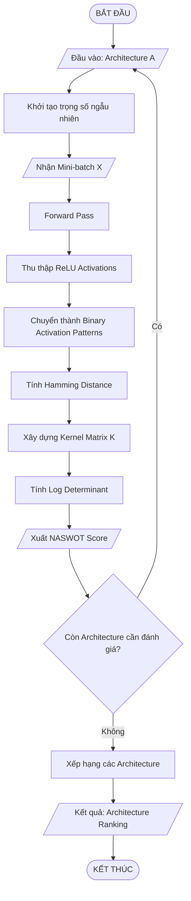

# NASWOT 
> Câu hỏi được đặt trong paper: Sao để đánh giá AI brain có tốt hay không mà hoàn toàn không cần train từ trước? 

**Thông tin paper**
| Các mục | Thông tin |
|---|---|
| Tên paper | *Neural Architecture Search without Training* |
| Tác giả | Joseph Mellor, Jack Turner, Amos Storkey, Elliot J. Crowley |
| arXiv | [2006.04647](https://arxiv.org/abs/2006.04647) |
| Paper chính thức | [PMLR](https://proceedings.mlr.press/v139/mellor21a.html) |
| PDF | [PMLR PDF](https://proceedings.mlr.press/v139/mellor21a/mellor21a.pdf) |
| Code | [BayesWatch/nas-without-training](https://github.com/BayesWatch/nas-without-training) |

**NAS**
> Ban đầu, khi chưa tiếp cận đến NAS và các paper liên quan, em cho rằng: Các neural network được quyết định hoàn toàn bằng dữ liệu và quy trình train; nhưng, ở đây - tác giả và các lý thuyết đã cho em thấy các vấn đề về kiến trúc của mạng neural cũng có thể ảnh hưởng đến khả năng học; khi đó những thành phần gây ra ảnh hưởng bao gồm: số layers, số channel, convolution, pooling, skip connection và các phép toán liên quan. Khi đó, NAS là một hướng nghiên cứu sẽ dùng để tự tìm hoàn toàn một kiến trúc phù hợp trong dãy có rất nhiều lựa chọn liên quan. 

Đặt không gian các kiến trúc là tập $\mathcal{A}$, như sau:

$$
\mathcal{A} = \{A_1, A_2, \ldots, A_M\}.
$$

Khi đó, với cách đánh giá chuẩn, mỗi kiến trúc được tạo mới; được train một phần hoặc toàn bộ rồi đo accuracy; được biểu diễn bởi biểu thức sau:

$$
A^* = \arg\max_{A_i \in \mathcal{A}} \mathrm{Acc}_{\mathrm{val}}(A_i).
$$

> Tương tự như trên, khi xếp hàng nghìn kiến trúc hoàn toàn để train thử sẽ khiến NAS tốn runtime, tài nguyên, ... Từ đó, nhiều phương pháp NAS được tìm ra để cắt giảm bớt các vấn đề trên.

**NASWOT khi này có tác dụng**
> (Trong approach có viết) Có thể đánh giá sơ bộ hoàn toàn một neural network ngay tại lúc nó được khởi tạo, trước thời gian training - bằng cách dựa vào các input tạo ra activation pattern?

Câu hỏi này, ý muốn nói: Thay vì phải đợi sau khi training từng kiến trúc mới có thể rõ được acc, NASWOT khi này sẽ quan sát các ReLU units khi vừa chạy qua một network chưa training. Sau đó, tạo nên một phương pháp xây dựng kernel matrix và tìm cách tính các scalar score. Từ đó, sẽ dùng các score này để xếp hạng kiến trúc mà không cần qua từng quá trình training lẻ. Khi đó, paper này cho thấy được các tương quan với validation acc sau training (trên nhiều search spaces sau khảo sát). Chính vì thế, mối tương quan này chỉ có thể xem là được rút ra trong quá trình thực nghiệm, và chưa thật sự chứng minh rõ vấn đề của NASWOT score cao thì "chắc chắn" acc cao.

**ReLU Unit**
> Khi xét một mạng neural tại vị trí vừa khởi tạo, tác giả đặt ra thứ được xem rõ nhất là cách phản ứng vớ từng đầu vào của các nút (Khi này được xem là trạng thái bật/tắt của các nút liên quan).

Trong đây, khi xét ở một đơn vị nhỏ của network; với mỗi phần được đặc trưng cho từng unit khác nhau; khi xét $A$ (1101), $B$ (1001) và $C$ (0011); khi đó: $A \neq B$ ở 1 vị trí và $A \neq C$ ở 3 vị trí. NASWOT khi này dùng sự giống và khác nhau giữa các mẫu $0/1$ này. Nếu xét các input tạo ra activation code giống nhau thì đều được xem là nằm trong cùng một vùng kích hoạt của mạng. Nếu các giá trị $0/1$ được xếp hoàn toàn khác nhau thì xem là nó đang kích hoạt các cấu hình ReLU khác nhau. Khi đó, có thể được hiểu: NASWOT sẽ không trực tiếp tính các acc, loss, adversarial robustness, ... mà nó được xem là dùng để tính một proxy từ activation patterns ở giai đoạn bắt đầu, và outcome khi đó là các ground truth target để kiểm tra xem proxy có xếp hạng đúng dựa trên các quá trình thực tế hay không.

## Lý thuyết

**Hàm ReLU được định nghĩa:** 

$$
\phi(z) = \mathrm{ReLU}(z) = \max(0, z).
$$

Có hai trường hợp được hiểu là:

$$
\phi(z) =
\begin{cases}
z, & z > 0, \\
0, & z \leq 0.
\end{cases}
$$

Để chỉ ghi lại trạng thái bật/tắt, ta dùng chỉ báo nhị phân:

$$
c(z) =
\begin{cases}
1, & z > 0, \\
0, & z \leq 0.
\end{cases}
$$

Ở đây, 1 không được cho là một output của ReLU; nó được xem là trạng thái cho biết hoàn toàn ReLU đang active. Output ReLU thực tế vẫn được xem là $\max(0, z)$. Khi đó:

| Giá trị trước ReLU $z$ | Output ReLU | Mã trạng thái |
|---:|---:|---:|
| 2.5 | 2.5 | 1 |
| 0.3 | 0.3 | 1 |
| 0 | 0 | 0 |
| -1.2 | 0 | 0 |

**Activation pattern**
Giả sử khi đang xét tất cả ReLU units trong mạng. Với input thứ $i$, ghép các trạng thái active/inactive thành một vector, ta sẽ được:

$$
\mathbf{c}_i = (c_{i,1}, c_{i,2}, \ldots, c_{i,N_A}) \in \{0, 1\}^{N_A}.
$$

Trong đó:
- $i$: chỉ số input trong mini-batch;
- $j$: chỉ số ReLU unit;
- $N_A$: tổng số ReLU units được xét;
- $c_{i,j}$: trạng thái của unit $j$ khi xử lý input $i$.

Nếu mini-batch có $B$ ảnh thì ta có $B$ activation codes. Chúng ta hoàn toàn có thể xếp chúng thành ma trận:

$$
C \in \{0, 1\}^{B \times N_A}.
$$

Mỗi hàng tương ứng một input; mỗi cột tương ứng một ReLU unit.

**Activation pattern liên quan đến linear region**
> Em nhận ra phần này thế này: ReLU hoàn toàn có thể xen là chúng không phải một đường cong trơn tru duy nhất, mà nó chia các không gian đầu vào thành một hoặc rất nhiều mảnh nhỏ, mỗi mảnh là một hàm tuyến tính; khi ghép các hàm tuyến tính đó lại, có thể xem chúng là một ReLU thực tế.

Khi mà một mạng chỉ bao gồm các phép tuyến tính xen kẽ ReLU là một hàm piecewise linear. Khi trạng thái active/inactive của các ReLU được cố định, mỗi ReLU có thể được xem như một phép nhân với $1$ hoặc $0$. Khi đó, mạng trong vùng tương ứng được biểu diễn bằng một chuỗi các ánh xạ tuyến tính có chèn các ma trận đường chéo $0/1$. Vì vậy, activation code xác định một cấu hình linear region của mạng ReLU. Hai input có cùng code sẽ kích hoạt cùng một cấu hình ReLU trong cách mô tả. [1, Sec. 3]

- Từ đó, nếu hai ảnh có cùng mẫu bật/tắt, network tại initialization đang phản ứng với chúng theo cùng một cấu hình tuyến tính. Nếu code khác nhau, chúng tạo ra cấu hình phản ứng khác nhau.
- Cùng activation code cũng không có nghĩa hai ảnh chắc chắn không thể được phân loại khác nhau sau training. NASWOT dùng đây như một tín hiệu khởi tạo có ích trong thực nghiệm, không phải một kết luận về khả năng học.

**Hamming distance**
Để đo xem các mạng khác nhau đến mức nào, đếm số vị trí lệch nhau giữa hai vector nhị phân của chúng; ta được những yếu tố như sau:

$$
d_H(\mathbf{c}_i, \mathbf{c}_j) = \sum_{k=1}^{N_A} \mathbb{1}[c_{i,k} \neq c_{j,k}].
$$

Trong đó $\mathbb{1}[\cdot]$ sẽ hiểu là bằng $1$ nếu điều kiện đúng và bằng $0$ nếu sai.

$$
\mathbf{c}_A = 1101, \qquad \mathbf{c}_B = 1001.
$$

| Vị trí | $A$ | $B$ | Khác nhau |
| :---: | :---: | :---: | :---: |
| 1 | 1 | 1 | 0 |
| 2 | 1 | 0 | 1 |
| 3 | 0 | 0 | 0 |
| 4 | 1 | 1 | 0 |

Do đó:

$$
d_H(\mathbf{c}_A, \mathbf{c}_B) = 1.
$$

Nếu hai code giống nhau hoàn toàn thì được định nghĩa distance bằng $0$. Nếu cả bốn vị trí đều khác thì định nghĩa distance khi này được xem là bằng $4$.

## Công thức
> Sau khi đã đo được hoàn toàn độ khác biệt giữa từng cặp ảnh bằng hamming distance, chúng ta sẽ gom toàn bộ các cặp trong mini-batch lại thành một ma trận duy nhất để tính score cho bộ kiến trúc.

Xét kernel matrix, nếu: giả sử mini-batch có $B$ input và mỗi activation code có $N_A$ phần tử. NASWOT định nghĩa kernel matrix:

$$
\boxed{
K_H(i,j) = N_A - d_H(\mathbf{c}_i, \mathbf{c}_j)
}
\tag{1}
$$

Đây là Eq. (1) trong Section 3 của paper. [1, Eq. (1)]

Ý nghĩa từng thành phần:
- $K_H(i,j)$: mức overlap activation giữa input $i$ và $j$;
- $N_A$: tổng số ReLU units được xét;
- $d_H$: số trạng thái activation khác nhau.

Có thể viết tương đương:

$$
K_H(i,j) = \sum_{k=1}^{N_A} \mathbb{1}[c_{i,k} = c_{j,k}].
$$

Hai biểu thức tương đương vì tại mỗi vị trí, hoặc trạng thái giống nhau, hoặc khác nhau.

**Một số tính chất**
1. Đối xứng: $K_H(i,j) = K_H(j,i)$, vì Hamming distance đối xứng.
2. Đường chéo: $K_H(i,i) = N_A$, vì một code so với chính nó có khoảng cách $0$.
3. Giá trị: $0 \leq K_H(i,j) \leq N_A$.
4. Kích thước: $K_H \in \mathbb{R}^{B \times B}$.

Kernel overlap này được xem hoàn toàn giống như các tổng các ma trận tương đồng 1/0 theo các đơn vị trên từng ReLU unit. Với từng unit, ma trận cùng trạng thái có thể biểu diễn từ vector chỉ báo active/inactive, vì thế kernel lý tưởng có cấu trúc positive semidefinite. Khi đó thì: trong code thực tế vẫn phải kiểm tra hoàn toàn các numerical stability.

**kernel được thử positive semidefinite**
Với ReLU unit thứ $k$, gom trạng thái của mọi input thành vector $\mathbf{c}_{:,k}$. Ma trận thể hiện “cùng trạng thái” ở unit đó có thể viết rằng:

$$
K^{(k)} = \mathbf{c}_{:,k}\mathbf{c}_{:,k}^{T} + (\mathbf{1} - \mathbf{c}_{:,k})(\mathbf{1} - \mathbf{c}_{:,k})^{T}.
$$

Mỗi hạng là một outer product, nên positive semidefinite. Cộng qua mọi ReLU units:

$$
K_H = \sum_{k=1}^{N_A} K^{(k)}
$$

cho ta một ma trận positive semidefinite trong cách xây dựng này. Chính vì thế, có thể giải thích vì sao kernel phù hợp để phân tích bằng determinant/eigenvalues. Tuy nhiên, ma trận vẫn có thể suy biến nếu các activation codes phụ thuộc tuyến tính; khi triển khai vẫn cần kiểm tra conditioning và numerical stability.

**Ví dụ**
Giả sử các ba input và bốn ReLU units:

| Input | ReLU 1 | ReLU 2 | ReLU 3 | ReLU 4 |
| :---: | :---: | :---: | :---: | :---: |
| A | 1 | 1 | 0 | 1 |
| B | 1 | 0 | 0 | 1 |
| C | 0 | 0 | 1 | 1 |

Ta tính:

$$
\begin{aligned}
d_H(A,B) &= 1, \\
d_H(A,C) &= 3, \\
d_H(B,C) &= 2.
\end{aligned}
$$

Với $N_A = 4$:

$$
K_H =
\begin{bmatrix}
4 & 3 & 1 \\
3 & 4 & 2 \\
1 & 2 & 4
\end{bmatrix}.
$$

Kiểm tra từng phần tử:
- $K_H(A,A) = 4$: A giống chính nó ở cả bốn vị trí.
- $K_H(A,B) = 4 - 1 = 3$: A và B giống nhau ở ba vị trí.
- $K_H(A,C) = 4 - 3 = 1$: A và C chỉ giống nhau ở một vị trí.
- $K_H(B,C) = 4 - 2 = 2$: B và C giống nhau ở hai vị trí.

Với ma trận minh họa này:

$$
\det(K_H) = 20, \qquad s = \log 20 \approx 2.9957.
$$

**Log-determinant score**
> Khi được xem là đã có ma trận $K_H$, vấn đề tiếp theo là làm sao rút gọn cả bảng số $B \times B$ này thành một con số duy nhất để đem đi xếp hạng - Như đã được xem ở trên, NASWOT dùng định thức của ma trận.

Sau khi có kernel matrix, NASWOT tính:

$$
\boxed{s = \log|K_H|}
\tag{2}
$$
Đây là Eq. (2) trong paper. [1, Eq. (2)]

Lý do để tác giả dùng log, với các ý nghĩa là:

- Nếu các input tạo ra activation codes gần như giống hệt nhau, các hàng/cột của kernel matrix có thể rất giống nhau.
- Khi các hàng/cột phụ thuộc mạnh, determinant có xu hướng giảm.
- Khi cấu trúc các mẫu đa dạng hơn, determinant có thể lớn hơn.

Paper quan sát rằng, với hai kernel có cùng trace, score cao hơn khi kernel gần dạng đường chéo hơn. Tác giả dùng điều này để giải thích vì sao score có thể báo hiệu khả năng đạt accuracy tốt hơn sau training. [1, Sec. 3]

Determinant có thể rất lớn hoặc rất nhỏ khi ma trận có kích thước lớn. Dùng log giúp đưa tích các eigenvalues về tổng log-eigenvalues:

$$
\log\det(K_H) = \sum_{i=1}^{B} \log\lambda_i,
$$

nếu ma trận đối xứng positive definite với eigenvalues dương $\lambda_i$. Log giúp xử lý scale số tốt hơn, dù không loại bỏ mọi vấn đề numerical stability.

**Chứng minh về chi phí tính toán**

Với batch size $B$ và tổng số ReLU units $N_A$:
- Thu activation và tạo binary codes: tỷ lệ với số activation được tính;
- So sánh mọi cặp code theo cách trực tiếp: $O(B^2 N_A)$;
- Lưu kernel matrix: $O(B^2)$;
- Tính determinant/log-determinant bằng phân rã ma trận: xấp xỉ $O(B^3)$.

Đây là lý do tăng batch size không chỉ tăng lượng input cần forward mà còn làm kernel matrix lớn lên theo bình phương và phép phân rã ma trận tăng theo bậc ba. Có thể dùng vector hóa/chunking để giảm memory peak khi tạo kernel, nhưng determinant vẫn nguyên.

Nếu hai input có activation codes trùng hoàn toàn hoặc các code phụ thuộc tuyến tính, kernel matrix có thể singular:

$$
\det(K_H) = 0 \quad\Rightarrow\quad \log 0 = -\infty.
$$

Trong implementation, thường dùng `torch.linalg.slogdet` thay vì tính determinant trực tiếp. Có thể thêm jitter:

$$
K_\epsilon = K_H + \epsilon I.
$$

Jitter là biện pháp số học trong implementation; phải ghi rõ giá trị $\epsilon$, vì nó làm thay đổi ma trận được score so với công thức lý tưởng trong paper.

## Biến Logic

## NASWOT và 2 paper liên quan:
> Khi đặt NASWOT cạnh các phương pháp Zero-Cost NAS khác, có thể thấy mỗi hướng tiếp cận lại khai thác một tín hiệu rất khác nhau tại thời điểm mạng mới khởi tạo:
- NASWOT khai thác activation patterns (cách mạng phân chia vùng tuyến tính) và cần input mini-batch để quan sát phản ứng của mạng.
- SynFlow khai thác weight/gradient của một objective nhân tạo (cho chạy tín hiệu toàn số $1$ qua mạng) và không cần dữ liệu thật. Cả hai đều có thể được dùng như tín hiệu ở initialization, nhưng trả lời hai câu hỏi khác nhau: một bên xem mạng phân tách dữ liệu đầu vào có đa dạng không, một bên xem dòng chảy gradient qua các tầng có bị triệt tiêu hay không.
- SZNAS biểu diễn proxy dưới dạng expression tree sử dụng tensor statistics. Tác giả chỉ ra thiết kế EZNAS gốc chỉ áp dụng expression lên thống kê của từng instance rồi aggregate trên một mini-batch, chứ không so sánh trực tiếp từng cặp input samples với nhau. Vì vậy, framework trong paper EZNAS gốc không thể tự khám phá ra đúng dạng NASWOT metric nếu không mở rộng program representation - bởi bản chất của NASWOT cần khai thác mối quan hệ tương đồng theo cặp giữa các mẫu dữ liệu thông qua kernel matrix.