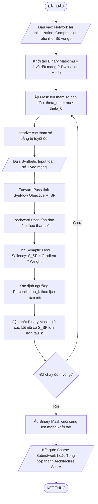

# SynFlow

> Câu hỏi đi xuyên suốt paper có thể xem là: Làm thế nào để cắt tỉa một neural network ngay tại thời điểm khởi tạo mà không cần bất kỳ dữ liệu nào, nhưng vẫn bảo toàn được luồng truyền tín hiệu và tránh làm đứt gãy các layer của mạng?

**Thông tin paper**

| Các mục | Thông tin |
| --- | --- |
| Tên paper | *Pruning Neural Networks without Any Data by Iteratively Conserving Synaptic Flow* |
| Tác giả | Hidenori Tanaka, Daniel Kunin, Daniel L. K. Yamins, Surya Ganguli |
| Năm / Hội nghị | 2020 - Advances in Neural Information Processing Systems (NeurIPS 2020) |
| Nơi xuất bản | Proceedings of Advances in Neural Information Processing Systems 33 |
| arXiv | [2006.05467](https://arxiv.org/abs/2006.05467) |
| Paper chính thức | [NeurIPS proceedings](https://proceedings.neurips.cc/paper_files/paper/2020/hash/46a4378f835dc8040c8057beb6a2da52-Abstract.html) |
| PDF | [NeurIPS PDF](https://papers.nips.cc/paper_files/paper/2020/file/46a4378f835dc8040c8057beb6a2da52-Paper.pdf) |
| Mã nguồn | [ganguli-lab/Synaptic-Flow](https://github.com/ganguli-lab/Synaptic-Flow) |

**Pruning at Initialization**

> Ban đầu, khi tiếp cận với network pruning, em thường nghĩ rằng một neural network phải trải qua quá trình training hoàn chỉnh thì ta mới biết được weight nào quan trọng để giữ lại và weight nào dư thừa để cắt bỏ; nhưng hướng nghiên cứu pruning at initialization lại đặt ra bài toán tìm kiếm một sparse subnetwork có khả năng học tốt ngay từ lúc mạng vừa được khởi tạo, trước khi quá trình training diễn ra.

Xét một layer tuyến tính cơ bản:

$$y = Wx + b.$$

Khi thực hiện network pruning, không phải mọi tham số trong ma trận $W$ đều đóng góp ngang nhau vào khả năng biểu diễn của mạng. Để loại bỏ các kết nối có score thấp và tạo ra một sparse network, ta áp một binary mask có cùng kích thước với ma trận trọng số:

$$\mu \in \{0, 1\}^{\mathrm{shape}(W)}, \qquad W_\mu = \mu \odot W.$$

Ở đây $\odot$ là phép toán Hadamard product; nếu $\mu_{ij} = 1$ thì kết nối được giữ lại, nếu $\mu_{ij} = 0$ thì kết nối bị ngắt. Các phương pháp pruning at initialization trước đó như SNIP hay GraSP cố gắng chấm điểm và cắt tỉa tham số ngay tại thời điểm khởi tạo $\theta_0$, nhưng thường xuyên gặp phải một failure mode nghiêm trọng khi cắt ở tỷ lệ cao là layer-collapse. [1, Sec. 1–3]

**Layer-collapse**

> Khi dùng global pruning để xếp hạng toàn bộ weight trong mạng rồi cắt bỏ một lượng lớn tham số cùng lúc, một hiện tượng rất dễ xảy ra là một layer nào đó bị cắt sạch toàn bộ weight trong khi các layer khác vẫn còn tham số; lúc này đường truyền tín hiệu qua mạng bị đứt hoàn toàn và network mất khả năng học.

Nguyên nhân sâu xa của layer-collapse không chỉ nằm ở ngưỡng cắt mà xuất phát từ tính chất bảo toàn của các gradient-based saliency scores. Tác giả chứng minh rằng tổng saliency của mỗi layer bị ràng buộc bởi conservation law. Khi chia một tổng không đổi cho số lượng tham số trong layer, saliency trung bình của mỗi weight sẽ tỉ lệ nghịch với kích thước của layer đó. Hệ quả là các layer lớn có score trung bình trên từng weight rất nhỏ; nếu thực hiện global pruning chỉ trong một lần duy nhất (one-shot pruning), các layer lớn sẽ bị xóa sổ trước tiên và gây ra layer-collapse. [1, Sec. 3–4]

**SynFlow khi này có tác dụng**

> (Trong approach có viết) Có thể thiết kế một thuật toán pruning hoàn toàn không cần dữ liệu, vừa đảm bảo tính dương cho saliency score, vừa tuân theo conservation law và tự cân bằng lại phân bổ tham số qua nhiều vòng lặp để triệt tiêu hiện tượng layer-collapse?

Câu hỏi này dẫn tới ba trụ cột thiết kế của SynFlow:

* Positive scoring: sử dụng trị tuyệt đối của các tham số để tuyến tính hóa mạng, đảm bảo mọi saliency score đều mang giá trị không âm.
* Conservation: xây dựng một scalar objective hoàn toàn data-free (dùng synthetic input toàn số $1$) để dòng chảy synaptic saliency thỏa mãn định luật bảo toàn từ đầu vào đến đầu ra.
* Iteration: thay vì cắt một lần theo bảng xếp hạng cố định, SynFlow tính lại saliency score sau mỗi vòng cắt tỉa nhỏ; khi một layer bị mất bớt kết nối, các kết nối còn lại trong layer đó sẽ tự động được đẩy score cao lên ở vòng tiếp theo để tránh bị cắt hết. [1, Sec. 6]

Khi đọc paper này trong bối cảnh Zero-Cost NAS, cần phân biệt rõ hai khái niệm: thuật toán gốc của SynFlow là iterative pruning dùng để tìm sparse subnetwork, còn trong các nghiên cứu NAS về sau, người ta cộng tổng SynFlow saliency của toàn bộ tham số tại vòng đầu tiên để làm một scalar proxy dùng cho việc xếp hạng architecture.

## Lý thuyết

**Sparsity và Compression ratio**
Gọi $N$ là tổng số tham số ban đầu của mạng và $N_{\mathrm{remain}}$ là số tham số còn lại sau khi áp binary mask. Tỷ lệ tham số đã bị loại bỏ được đo bằng sparsity:

$$\mathrm{sparsity} = 1 - \frac{N_{\mathrm{remain}}}{N}.$$

Ngược lại, paper định nghĩa đại lượng compression ratio $\rho$ là tỷ số giữa số tham số ban đầu và số tham số giữ lại:

$$\boxed{ \rho = \frac{N}{N_{\mathrm{remain}}} }$$

Hai đại lượng này biểu diễn cùng một trạng thái nén nhưng theo hai góc nhìn khác nhau:

| Compression ratio $\rho$ | Tỷ lệ tham số giữ lại $1/\rho$ | Sparsity tương ứng |
| --- | --- | --- |
| 1 | 100% | 0% |
| 10 | 10% | 90% |
| 100 | 1% | 99% |
| 1000 | 0.1% | 99.9% |

**Gradient-based Synaptic Saliency**
Để ước lượng mức độ quan trọng của từng tham số $\theta$ đối với một hàm mục tiêu vô hướng $\mathcal{R}$, paper xét lớp tổng quát của các gradient-based synaptic saliency:

$$\boxed{ \mathcal{S}(\theta) = \frac{\partial \mathcal{R}}{\partial \theta} \odot \theta } \tag{1}$$

Trong đó:

* $\theta$: tập tham số của neural network;
* $\mathcal{R}$: một scalar objective tính từ đầu ra của mạng;
* $\frac{\partial \mathcal{R}}{\partial \theta}$: gradient phản ánh độ nhạy của $\mathcal{R}$ khi tham số thay đổi;
* $\odot$: phép toán Hadamard product;
* $\mathcal{S}(\theta)$: vector/tensor chứa saliency tương ứng với từng tham số.

Nếu xét riêng một weight đơn lẻ $w$, mức đóng góp của nó là $S(w) = w \frac{\partial \mathcal{R}}{\partial w}$, kết hợp cả độ lớn hiện tại của weight lẫn tốc độ biến thiên của hàm mục tiêu theo weight đó. Các phương pháp như SNIP, GraSP hay SynFlow khác nhau ở cách chọn hàm mục tiêu $\mathcal{R}$ và phép biến đổi trên đạo hàm. [1, Eq. (1); Sec. 4]

**Homogeneous Activation và Conservation Law**

> Điểm thú vị nhất về mặt toán học trong Section 4 là khi các hàm kích hoạt có tính chất positively homogeneous, mạng neural hoạt động giống hệt một mạng lưới dòng chảy bảo toàn: tổng saliency đi vào một hidden neuron luôn bằng đúng tổng saliency đi ra khỏi neuron đó.

Một hàm kích hoạt $\phi$ được gọi là positively homogeneous bậc $1$ nếu thỏa mãn:

$$\phi(\alpha z) = \alpha \phi(z), \qquad \forall \alpha \geq 0.$$

Các hàm phổ biến như ReLU, Leaky ReLU hay phép biến đổi tuyến tính đều thỏa mãn tính chất này. Dưới điều kiện các hàm kích hoạt trong mạng là positively homogeneous bậc $1$ (và không xét bias hoặc BatchNorm làm lệch tính thuần nhất), paper chứng minh định luật bảo toàn ở cấp độ từng neuron $j$ với tập kết nối đi vào $\mathrm{In}(j)$ và tập kết nối đi ra $\mathrm{Out}(j)$:

$$\mathcal{S}_j^{\mathrm{in}} = \sum_{w \in \mathrm{In}(j)} S(w), \qquad \mathcal{S}_j^{\mathrm{out}} = \sum_{w \in \mathrm{Out}(j)} S(w) \quad \Longrightarrow \quad \boxed{ \mathcal{S}_j^{\mathrm{in}} = \mathcal{S}_j^{\mathrm{out}} }$$

Ở cấp độ toàn mạng, nếu xét bất kỳ một lát cắt tham số nào chia cắt toàn bộ đường đi từ input $x$ đến output $y$ (ví dụ toàn bộ các weight thuộc cùng một layer thứ $l$), tổng synaptic saliency trên layer đó luôn bằng một hằng số bảo toàn xác định bởi hai biên:

$$\sum_{w \in W^{[l]}} S(w) = \left\langle \frac{\partial \mathcal{R}}{\partial x}, x \right\rangle = \left\langle \frac{\partial \mathcal{R}}{\partial y}, y \right\rangle.$$

[1, Theorem 1; Theorem 2]

* Trực giác: Vì mọi layer cắt ngang mạng đều phải gánh cùng một tổng lượng synaptic flow từ đầu vào sang đầu ra, tổng độ quan trọng của cả một layer nhỏ hay một layer lớn đều bằng nhau.
* Giới hạn của trực giác: Định luật bảo toàn này nói về bảo toàn giá trị toán học của biểu thức $\frac{\partial \mathcal{R}}{\partial \theta} \odot \theta$ dưới hàm positively homogeneous, không đồng nghĩa rằng việc giữ nguyên tổng này trong một lần cắt sẽ ngăn được đứt gãy mạng. Chính sự bảo toàn tổng score này lại là nguyên nhân ép score trung bình của các layer nhiều tham số xuống thấp, gây ra layer-collapse nếu không đánh giá lại score qua nhiều bước lặp. [1, Sec. 3–5]

**Ví dụ tính bằng tay cơ chế Layer-collapse**
Giả sử một mạng gồm hai layer nối tiếp có cùng tổng synaptic saliency bảo toàn bằng $100$, nhưng kích thước tham số chênh lệch gấp $10$ lần:

| Layer | Số lượng weight | Tổng score của layer | Score trung bình mỗi weight |
| --- | --- | --- | --- |
| Layer 1 | 100 | 100 | 1.0 |
| Layer 2 | 1000 | 100 | 0.1 |

Khi áp dụng global pruning một lần duy nhất để giữ lại $100$ weight có score cao nhất toàn mạng, gần như toàn bộ các weight ở Layer 2 (vốn chỉ có score xoay quanh mức $0.1$) sẽ bị xếp dưới các weight của Layer 1 (xoay quanh mức $1.0$) và bị cắt bỏ hoàn toàn, dẫn tới Layer 2 bị sụp đổ. Nếu dùng iterative pruning, ngay khi một phần weight của Layer 2 bị cắt ở vòng đầu, định luật bảo toàn vẫn buộc tổng score của các weight còn lại trong Layer 2 phải bằng $100$, từ đó kéo score trung bình của những kết nối còn sống sót tại Layer 2 tăng vọt lên ở vòng sau và giúp chúng không bị xóa tiếp.

## Công thức

> Để tạo ra một thước đo vừa dương hoàn toàn vừa không cần dữ liệu thật, SynFlow thay toàn bộ các hàm kích hoạt phi tuyến và dấu của trọng số bằng trị tuyệt đối, rồi cho một vector toàn số $1$ chảy xuyên qua mạng.

**Synaptic Flow Objective**
Ở trạng thái mạng đã được áp dụng linearization bằng cách lấy trị tuyệt đối từng ma trận trọng số $W^{[l]} \longrightarrow |W^{[l]}|$ qua $L$ layers và đưa vào synthetic input toàn số $1$ là $\mathbf{1} = (1, 1, \ldots, 1)^T$, SynFlow định nghĩa hàm mục tiêu:

$$\boxed{
\mathcal{R}_{\mathrm{SF}} = \mathbf{1}^T \left( \prod_{l=1}^{L} |W^{[l]}| \right) \mathbf{1}
}
\tag{2}$$

Đây là Eq. (2) trong Section 6 của paper. [1, Eq. (2)]

Ý nghĩa từng thành phần:

* $L$: tổng số layer trong chuỗi biến đổi của feed-forward network;
* $|W^{[l]}|$: ma trận trọng số tại layer thứ $l$ đã lấy trị tuyệt đối từng phần tử để tránh việc các đường truyền mang dấu âm và dương tự triệt tiêu nhau;
* $\prod_{l=1}^{L} |W^{[l]}|$: tích ma trận tuần tự từ layer đầu tiên đến layer cuối cùng;
* $\mathbf{1}$: vector toàn số $1$ ở chiều đầu vào và chiều đầu ra, giúp $\mathcal{R}_{\mathrm{SF}}$ chỉ phụ thuộc vào cấu trúc và độ lớn trọng số mà không cần dữ liệu hay nhãn thực tế.

**Synaptic Flow Saliency**
Từ hàm mục tiêu $\mathcal{R}_{\mathrm{SF}}$, độ quan trọng của từng tham số được tính thông qua công thức:

$$\boxed{
\mathcal{S}_{\mathrm{SF}}(\theta) = \frac{\partial \mathcal{R}_{\mathrm{SF}}}{\partial \theta} \odot \theta
}
\tag{3}$$

Đối với một tham số vô hướng $w$ (khi tính trên mạng đã lấy trị tuyệt đối), giá trị saliency là:

$$S_{\mathrm{SF}}(w) = \frac{\partial \mathcal{R}_{\mathrm{SF}}}{\partial \vert{}w|} |w|.$$

Đây là Eq. (3) trong paper. [1, Eq. (3)]

**Một số tính chất**

1. Không âm (Positive scoring): Do mọi phần tử trong tích ma trận đều không âm, cả đạo hàm $\frac{\partial \mathcal{R}_{\mathrm{SF}}}{\partial \vert{}w|}$ lẫn $|w|$ đều không âm, đảm bảo $S_{\mathrm{SF}}(w) \geq 0$.
2. Ý nghĩa hình học theo đường đi ($\ell_1$-path norm): $\mathcal{R}_{\mathrm{SF}}$ chính là tổng trọng số của tất cả các đường đi từ mọi nút input đến mọi nút output, còn $S_{\mathrm{SF}}(w)$ đo lường phần tổng trọng số của riêng những đường đi có chạy qua kết nối $w$.
3. Mở rộng từ Magnitude Pruning: Thay vì chỉ nhìn độ lớn cục bộ $|w|$ của một kết nối đứng cô lập, SynFlow nhân $|w|$ với tổng độ mạnh của các nhánh nối vào và đi ra khỏi nó qua toàn bộ các layer còn lại.
4. Thỏa mãn định luật bảo toàn: Vì phép nhân tuyến tính với $|W^{[l]}|$ là hàm positively homogeneous bậc $1$, tổng $S_{\mathrm{SF}}(w)$ trên mỗi layer đều bằng chính $\mathcal{R}_{\mathrm{SF}}$.

**Ví dụ tự tạo**
Xét một feed-forward network gồm $2$ nút đầu vào, $2$ nút ẩn và $1$ nút đầu ra, không có bias, với hai ma trận trọng số dương:

$$W_1 = \begin{bmatrix} 1 & 2 \\ 3 & 4 \end{bmatrix}, \qquad W_2 = \begin{bmatrix} 5 & 6 \end{bmatrix}.$$

Vì mọi phần tử đều dương nên $|W_1| = W_1$ và $|W_2| = W_2$. Với vector đầu vào $\mathbf{1} = \begin{bmatrix} 1 \\ 1 \end{bmatrix}$, ta tính lần lượt theo Eq. (2):

$$W_1 \mathbf{1} = \begin{bmatrix} 1 & 2 \\ 3 & 4 \end{bmatrix} \begin{bmatrix} 1 \\ 1 \end{bmatrix} = \begin{bmatrix} 3 \\ 7 \end{bmatrix}.$$

Nhân tiếp qua layer thứ hai để thu được $\mathcal{R}_{\mathrm{SF}}$:

$$\mathcal{R}_{\mathrm{SF}} = W_2 (W_1 \mathbf{1}) = \begin{bmatrix} 5 & 6 \end{bmatrix} \begin{bmatrix} 3 \\ 7 \end{bmatrix} = 5 \times 3 + 6 \times 7 = 15 + 42 = 57.$$

Tiếp theo, ta tính gradient và Synaptic Flow saliency theo Eq. (3) cho từng layer:

* Tại Layer 1:

$$\frac{\partial \mathcal{R}_{\mathrm{SF}}}{\partial W_1} = W_2^T \mathbf{1}^T = \begin{bmatrix} 5 \\ 6 \end{bmatrix} \begin{bmatrix} 1 & 1 \end{bmatrix} = \begin{bmatrix} 5 & 5 \\ 6 & 6 \end{bmatrix} \implies S_{\mathrm{SF}}(W_1) = \begin{bmatrix} 5 & 5 \\ 6 & 6 \end{bmatrix} \odot \begin{bmatrix} 1 & 2 \\ 3 & 4 \end{bmatrix} = \begin{bmatrix} 5 & 10 \\ 18 & 24 \end{bmatrix}.$$

* Tại Layer 2:

$$\frac{\partial \mathcal{R}_{\mathrm{SF}}}{\partial W_2} = (W_1 \mathbf{1})^T = \begin{bmatrix} 3 & 7 \end{bmatrix} \implies S_{\mathrm{SF}}(W_2) = \begin{bmatrix} 3 & 7 \end{bmatrix} \odot \begin{bmatrix} 5 & 6 \end{bmatrix} = \begin{bmatrix} 15 & 42 \end{bmatrix}.$$

Kiểm tra lại định luật bảo toàn qua hai layer:

* Tổng saliency tại Layer 1: $5 + 10 + 18 + 24 = 57$.
* Tổng saliency tại Layer 2: $15 + 42 = 57$.
Hai tổng bằng nhau và bằng đúng giá trị $\mathcal{R}_{\mathrm{SF}} = 57$.

*(Đây là ví dụ tự tạo để học cách tính, không phải kết quả thực nghiệm trong paper.)*

**Iterative Synaptic Flow Pruning và lịch cắt tỉa hàm mũ**

> Có được công thức chấm điểm bảo toàn rồi, bước quyết định để không làm sập các layer lớn là chia quá trình cắt tỉa thành $n$ vòng lặp nhỏ theo lịch hàm mũ, chấm điểm lại mạng sau mỗi lần cập nhật binary mask.

Với mục tiêu nén đạt compression ratio $\rho$ sau $n$ vòng lặp, tại vòng thứ $k \in \{1, 2, \ldots, n\}$, thuật toán tính lại $\mathcal{S}_{\mathrm{SF}}(\mu \odot \theta_0)$ trên mạng hiện tại rồi xác định ngưỡng cắt $\tau_k$ theo phân vị (percentile):

$$\boxed{ \tau_k = \left( 1 - \rho^{-k/n} \right)\text{-percentile of }\mathcal{S}_{\mathrm{SF}} } \tag{4}$$

Sau đó, binary mask được cập nhật bằng cách chỉ giữ lại các tham số có saliency vượt ngưỡng $\tau_k$:

$$\boxed{ \mu \leftarrow \mathbb{1}\left[ \tau_k \lt \mathcal{S}_{\mathrm{SF}} \right] } \tag{5}$$

Ở vòng cuối cùng $k = n$, tỷ lệ tham số bị loại bỏ tích lũy đạt đúng $1 - \rho^{-1} = 1 - \frac{N_{\mathrm{remain}}}{N}$. [1, Algorithm 1; Appendix 12]

Ví dụ với mục tiêu $\rho = 10$ (tức sparsity đạt $90\%$) được chia làm $n = 5$ vòng lặp, tỷ lệ phần trăm tham số bị cắt tích lũy $p_k = 1 - 10^{-k/5}$ qua từng vòng như sau:

| Vòng lặp $k$ | Biểu thức $1 - 10^{-k/5}$ | Percentile tích lũy bị loại bỏ (xấp xỉ) |
| --- | --- | --- |
| 1 | $1 - 10^{-0.2}$ | 36.9% |
| 2 | $1 - 10^{-0.4}$ | 60.2% |
| 3 | $1 - 10^{-0.6}$ | 74.9% |
| 4 | $1 - 10^{-0.8}$ | 84.2% |
| 5 | $1 - 10^{-1.0}$ | 90.0% |

**Từ SynFlow Saliency sang Zero-Cost Architecture Score**
Mặc dù mục tiêu gốc của SynFlow là tìm sparse subnetwork thông qua iterative pruning, các nghiên cứu về Zero-Cost NAS (như trong paper NASWOT [2, Fig. 4] và bài báo khảo sát Zero-Cost Proxies [3]) đã mượn trực tiếp giá trị saliency ở trạng thái khởi tạo để chấm điểm kiến trúc $A$ bằng cách lấy tổng qua toàn bộ tham số $\theta_A$:

$$S_{\mathrm{arch}}(A) = \sum_{w \in \theta_A} S_{\mathrm{SF}}(w).$$

Cách gom tổng này biến SynFlow thành một thước đo đánh giá độ thông suốt của luồng gradient qua toàn bộ kiến trúc mạng ngay tại thời điểm khởi tạo mà không cần chạy 100 vòng cắt tỉa.

**Chi phí tính toán và các lưu ý thực nghiệm**

* Số vòng lặp và chi phí: Trong bài toán pruning gốc, tác giả sử dụng $n = 100$ vòng lặp theo lịch hàm mũ để đảm bảo tránh hoàn toàn layer-collapse khi cấu trúc mạng cho phép. Vì vậy, tính chất data-free ở đây có nghĩa là không cần dùng ảnh hay nhãn từ dataset, chứ thuật toán vẫn tốn chi phí thực hiện $100$ lượt truyền xuôi và truyền ngược để cập nhật saliency. [1, Sec. 6; Appendix 12]
* Xử lý BatchNorm tại thời điểm khởi tạo: Vì ở thời điểm khởi tạo mạng chưa học được running statistics của dữ liệu, trạng thái hoạt động của các tầng chuẩn hóa ảnh hưởng trực tiếp đến dòng chảy tín hiệu; thuật toán của paper đặt mô hình ở evaluation mode trong suốt quá trình tính SynFlow. [1, Algorithm 1; Appendix 10]
* Hiệu năng trong high-compression regime: Thử nghiệm trên các kiến trúc VGG và ResNet với CIFAR-10, CIFAR-100 và Tiny ImageNet cho thấy ở mức nén cực cao (sparsity lên tới $99.99\%$), trong khi SNIP và GraSP bị sụt giảm độ chính xác nghiêm trọng do vướng phải layer-collapse, SynFlow vẫn giữ được đường truyền tín hiệu và duy trì khả năng học ổn định. [1, Fig. 6; Sec. 7]
* Hạn chế cố hữu: Do chỉ dùng vector đầu vào toàn số $1$ và lấy trị tuyệt đối tham số, SynFlow hoàn toàn không quan sát được phân phối dữ liệu thực tế (như nhiễu Gaussian, độ mờ hay đặc trưng hình học của từng dataset), đồng thời tổng score dễ bị thiên lệch theo quy mô số lượng tham số hoặc chiều sâu của kiến trúc khi đem dùng làm proxy xếp hạng trong NAS.

## Biến Logic

## SynFlow và 2 paper liên quan:

> Khi đặt SynFlow cạnh NASWOT và EZNAS, ta thấy rõ bức tranh toàn cảnh về cách khai thác tín hiệu của mạng neural ở trạng thái chưa huấn luyện từ ba góc độ khác nhau:

* SynFlow xuất phát từ bài toán pruning at initialization, hoàn toàn không dùng dữ liệu thật mà đẩy vector toàn số $1$ qua mạng đã tuyến tính hóa bằng trị tuyệt đối để đo lường và bảo toàn synaptic flow qua các tầng. Khi chuyển sang bài toán NAS, tổng SynFlow saliency trên toàn mạng được dùng như một zero-cost proxy phản ánh khả năng truyền dẫn gradient xuyên suốt cấu trúc mà không bị nghẽn.
* NASWOT được thiết kế trực tiếp cho bài toán architecture scoring, bắt buộc phải đưa một mini-batch dữ liệu thật qua mạng (dù không cần nhãn) để quan sát binary activation patterns của các nút ReLU. Nếu SynFlow kiểm tra xem dòng chảy trọng số dọc theo chiều sâu của mạng có bị triệt tiêu hay không, thì NASWOT lại kiểm tra xem kiến trúc đó có khả năng phân tách các mẫu dữ liệu đầu vào thành những linear regions đa dạng hay không.
* EZNAS đóng vai trò là một evolutionary framework dùng Genetic Programming để tự động ghép nối $34$ toán tử toán học trên $22$ tensor statistics (thu thập từ cả dữ liệu thật, nhiễu ngẫu nhiên và dữ liệu nhiễu trên từng khối RCB) nhằm tìm ra công thức xếp hạng kiến trúc tối ưu. Điểm giao thoa rất thú vị là công thức tốt nhất mà EZNAS tự tìm ra được (EZNAS-A) lại khai thác chính gradient của trọng số tích chập dưới đầu vào nhiễu ngẫu nhiên — tức là tự động hội tụ về hướng tiếp cận không phụ thuộc dữ liệu ảnh thật và dựa trên độ nhạy đạo hàm tương tự như tinh thần của SynFlow, nhưng đạt tương quan thứ hạng cao hơn trên các search spaces chuẩn.